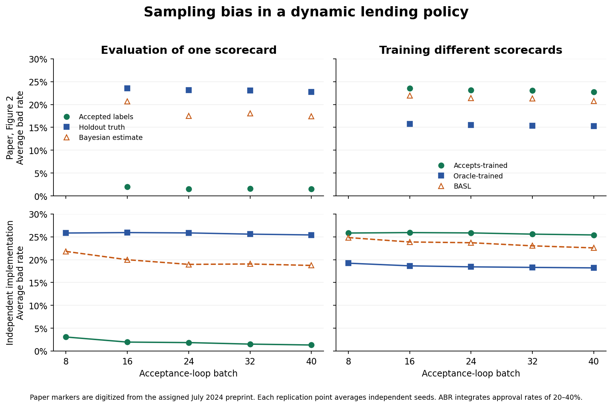

# Fighting Sampling Bias in Credit Scoring

HSE DSBA Research Seminar · Team 12 · Round 3 · Paper 11

Andrey Tsember, Sofia Shapovalova, Ksenia Stepanova, Marat Bineman and Alexia Fox

A bank learns how people repay the loans it approves. How well can it then score *all* applicants? We implement the training and evaluation methods in Kozodoi et al., compare them with the assigned paper, and ask when issuing a loan to observe its outcome can pay for itself. [Assigned paper and appendix](https://arxiv.org/abs/2407.13009v1) · [Journal article](https://www.sciencedirect.com/science/article/pii/S0377221725000839)

[Presentation (PDF)](slides/paper11.pdf) · [Editable slides and speaker notes](slides/paper11.pptx) · [Research report](results/report.md) · [Team contributions and assessment](docs/contributions.md)

## Replicating the paper

| Experiment | Published result | Our result |
|---|---:|---:|
| Simulation, error estimating the average bad rate among low-risk approvals (accepted-only → Bayesian) | 0.2010 → 0.0929 | 0.2433 → 0.0771 |
| Simulation, share of the full-label training gap recovered by bias-aware self-learning (BASL) | 24.82% | 29.61% [21.22%, 37.28%] |
| Empirical bad-rate estimation error (accepted-only → Bayesian) | 0.0356 → 0.0130 on Monedo | 0.01434 → 0.01350 on Taiwan; 0.01351 → 0.00354 on Prosper |
| Margin from choosing the approval cutoff by Bayesian evaluation | Authors report +$29.27 per $375 loan at 50% loss given default | Zero difference at base pricing in both public cohorts. Each method chose the same cutoff. |

Our simulation reproduces the direction of the training and evaluation results. On Taiwan, BASL increases the default rate integrated over the lowest-risk 20–40% of applicants by 0.165 percentage points relative to accepted-only training (conditional 95% interval +0.018 to +0.300). The Prosper training difference is close to zero. On both cohorts Bayesian evaluation has a smaller point error, but the paired intervals for improvement include zero. The published Spanish randomized holdout is private. Our Taiwan and Prosper comparisons hide and then reveal outcomes of previously financed accounts. [Four-metric comparison](results/paper_comparison.csv) · [Simulation design and departures](docs/simulation.md) · [Prior, masking and implementation](docs/algorithm.md)



## When can a pilot loan pay for information?

**Issue an otherwise loss-making pilot only if its expected loss is less than the discounted improvement in future decisions that its repayment reveals.** The comparison bank gets the ordinary risk updates it would receive even if it skipped the pilot. A change in estimated risk has value only when it can change an action that affects the margin.

In a stable illustrative regime, a pilot of 100 costs 1.4125 in expectation and adds 0.548125 per subsequent loan. Three later decisions cover that cost. If an independent regime replaces the old one with 10% probability per arrival, all future decisions together can be worth at most 0.70889. With heterogeneous borrowers, their marginal default risks alone can sometimes rule out funding the pilot under *every* possible dependence structure. The proof, independent numerical checks and a sequential model distinguish buying one signal from learning after every loan. [Break-even condition](docs/information-value.md) · [Sharp dependence bounds](docs/pilot-dependence.md) · [Sequential learning](docs/exploration.md)

### Two Estonian pilots and a counterexample

The old rule selected ten of 228 initially loss-making pilot opportunities in an expanded Bondora sample. Three replayed decisions changed. Two pilots recovered a direct loss through the later decision. Both were €530, half the recent median in their segment, on 36-month contracts with five previous loans. The other eight selected pilots had a median principal of €3,092.50.

| Returning Estonian customers | Principal / recent segment median | Subsequent decision in the replay | Net cash difference by 24 May 2024 |
|---|---:|---|---:|
| July 2018 | €530 / €955 | Unchanged | +€93.96, all from the pilot |
| October 2018 | €530 / €1,060 | Lend → decline | +€15,944.29 |
| November 2018 | €530 / €1,060 | Lend → decline | +€8,706.30 |
| February 2019 | €5,525 / €1,060 | Lend → decline | −€8,672.42 |

October's pilot lost €267. The next 25 loans had returned €16,211.29 less than principal including interest and penalties, so declining them in the replay covered the loss. Bondora funded all those loans. Later collections can change the measured gain. July shows why a small pilot is insufficient by itself. February shows how the same change in action can lose money. [All ten profiles and comparison groups](docs/pilot-profiles.md) · [Paired cash ledgers and collections risk](docs/lender-pilot.md)

Information access matters. If the bank gives past cohorts twice as much weight, **all three switches disappear**. They also disappear when both banks observe the other matured loans from the pilot's own cohort. This calculation keeps the same ten pilot choices and the same receipts. The ledger measures what borrowers paid. The modeled access to a useful private signal determines whether those receipts imply a gain from changing policy. [Signal-weight and peer-information sensitivity](docs/pilot-signal-sensitivity.md)

### Predicting recovery on untouched dates

The revised rule prices the pilot at its offered principal, forecasts the next portfolio's size from the preceding twelve months and allows for ordinary risk updates before the pilot matures. It never screens for Estonia, €530 or a particular borrowing history. We locked the formula, endpoints, follow-up horizon and data definitions in public commits before scoring the new cohorts. The independent-period test uses a later Bondora workbook with country and risk grade at issue. These are two time windows on the same platform. [Frozen rule](https://github.com/bigpurota/paper11/commit/0fda6dd) · [Frozen cohorts and cash definitions](https://github.com/bigpurota/paper11/commit/9110afd) · [Provider](https://goandgrow.eu/en/public-statistics/)

| Frozen test | Eligible opportunities | Pilots old → new | Strict cash recoveries found / available | New vs. skipping per eligible |
|---|---:|---:|---:|---:|
| Bondora, June–September 2024 | 0 | — | — | Unmeasurable |
| Bondora, July 2020–September 2022 | 23 | 0 → 2 | 0 / 1 | +€10.86 [€0.00, €21.41] |
| US Prosper, January 2008–January 2012 | 30 | 0 → 0 | 0 / 0 | $0.00 |

The primary window had 62,903 funded loans in 119 country–grade–month cells. Every loan carried a named grade; all 86,344 loans in the required historical window were unrated. There was no same-grade history to estimate risk on any of the 119 cells. The longer-seasoned panel supplied one strict cash recovery. A €1,141 Finnish pilot in March 2021 lost €386.82. Its default would have led the rule to decline 25 loans whose recorded cash shortfall was €4,103.74, leaving **+€3,716.92** after the pilot loss. Both rules passed on it. The two loans that the revised rule did select earned €249.80 in total, entirely from the pilots themselves. [Dates, cash, exposure and missingness](docs/pilot-holdout.md)

The **funding rule** and the **score for finding strict recoveries** answer different questions. The Finnish case ranked ninth of 23 at issue. The pooled ranking AUC was 0.636 [0.533, 1.000], clearing the prespecified 0.5 lower-bound criterion among the 1,810 of 2,500 resamples containing both outcomes. Within Finland the single success beat seven of fifteen negatives (AUC 0.467). In development the revised funding rule had kept both winners and the February loss, recommending 17 pilots to the old rule's ten. These observations do not establish dependable selection or a positive incremental cash gain on new loans. [Rank, coverage, ablations and paired intervals](results/pilot_rule_summary.csv)

For a **different lender**, we then locked a supplementary test on Prosper before computing its pilot outcomes. The archive was already used for other scorecard experiments. Of 31,947 funded loans in the origination window, 293 group–months had adequate history and 30 had a forecast direct loss. Neither rule lent in those 30. Three contingent decisions changed sign where the next group had zero borrowers. No strict cash recovery occurred, even when every eligible pilot was tried. [Prosper test and source accounting](docs/pilot-prosper.md) · [Public protocol](https://github.com/bigpurota/paper11/commit/11bf82d)


### What other lenders can establish

* **US SBA 504.** The fixed rule selected three of 79 initially loss-making region-quarters. All three subsequent actions stayed the same after the ordinary public update. The scenario gain per eligible episode was −0.022 (95% block interval −0.076 to +0.005), on loans of principal 100. [Dates, controls and assumptions](docs/pilot-replay.md)
* **US SBA 7(a).** The archive supplied 886,287 eligible historical disbursements. On the local pricing specification, the rule selected 16 of 85 loss-making opportunities. Four follow-up decisions changed. Its AUC for positive total scenario margin was 0.416 [0.206, 0.624]. A positive total can come from repayment of the pilot alone. [Borrower draws and observed write-offs](docs/pilot-transfer.md) · [Forecasts and uncertainty](docs/pilot-targeting.md)
* **Commercial Bank of Africa.** Knowledge from project TOBOA informed a documented revision to the M-Shwari scorecard. Reported acceptance rose from 40% to 47%. The case study gives no incremental cash profit attributable to the change. [Field evidence and primary sources](docs/observed-pilot-evidence.md)

## What to measure when outcomes are missing

| Question | Finding |
|---|---|
| Which information recovers the margin difference between every pair of five nested cutoff policies? | Four adjacent-band margin totals suffice. Under independently variable band margins, four independent linear measurements are necessary for all exact differences. Choosing a winner may take fewer. [Proof and 50 numerical checks](docs/policy-information.md) |
| Are actual default counts in ten risk groups enough? | Two completions of one Taiwan sample match all observed outcomes and all ten group counts, yet the 30%→50% expansion earns +0.900 or −0.888 percentage points per applicant. The Prosper group counts settle the sign. [Counterexamples and minimax regret](docs/identification.md) |
| How many hidden repayments settle one choice? | On Prosper, auditing a random subset needs 14.46 of 160 labels on average with the observed default count, or about 153 near break-even. The finite-population wrong-sign bound is 5%. [Sequential audit](docs/decision-audit.md) |
| Does better historical measurement improve forecasts? | Across twelve Prosper quarters the Bayesian correction reduces historical RMSE from 0.79 to 0.26 pp, while next-quarter forecast RMSE rises from 2.08 to 2.36 pp. [Calendar forecasts](docs/vintages.md) |
| How sensitive is a cutoff to missing outcomes? | The 30%→50% expansion keeps nonnegative worst-case conditional expected margin up to reject-odds multipliers of 1.85–2.30 across Taiwan splits and 13.19 on Prosper. [Policy bounds](docs/bounds.md) |
| What does randomized access establish? | In the Philippine experiment, extending offers to both score windows adds 8.02 pp in funding and 4.19 PPP dollars in cash margin per applicant before costs. The extract covers 1,113 marginal applicants. [Trial and cash-flow accounting](docs/rct.md) |
| Where should an audit spend 50 labels? | On Taiwan, drawing inside the candidate portfolio reduces bad-rate estimation RMSE from 2.01 to 0.86 pp relative to drawing from all rejects. [Equal-budget comparison](results/audit_summary.csv) |

## Reproduce

Python 3.12 and GNU Make. A CPU is sufficient. Downloading source data requires internet access. On macOS, install the OpenMP runtime if XGBoost needs it (`brew install libomp`).

```sh
git clone https://github.com/bigpurota/paper11.git
cd paper11
make all          # fetch verified sources and regenerate estimates, figures and report
make verify       # run reference, leakage and numerical checks on the submitted results
make reproduce    # rerun into an empty directory and compare each research artifact
make slides       # refresh PPTX and PDF using LibreOffice; the finished files are included
```

Nine fingerprinted source files total about 870 MB (decimal) in the ignored `data/cache/`. Use `PYTHON=/path/to/python3.12` for a differently named interpreter. The results directory contains aggregate research outputs, including paired episode-level receipts. [Dataset catalog](docs/sources.md) · [Analysis plan](docs/analysis-plan.md) · [Deviations](docs/deviations.md) · [Verification and CI](docs/verification.md)

Team 12 implemented the replication and its extensions with Codex assistance. Kozodoi and coauthors developed the original methods and conducted the Monedo study.
