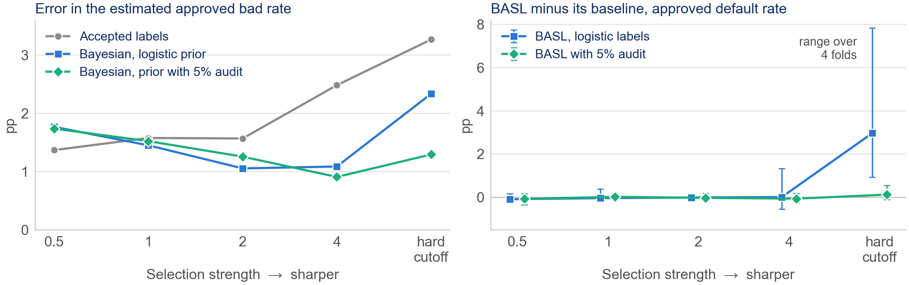
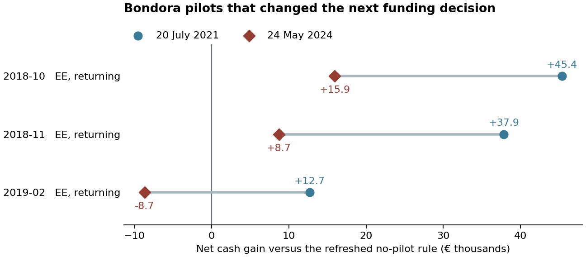
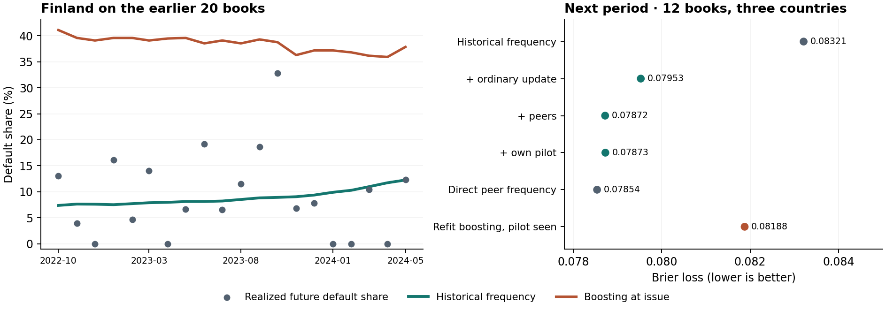

# Fighting Sampling Bias in Credit Scoring

A bank sees who repays only after it lends. How well can it judge a rule that would approve people it previously turned away? We replicate two methods for handling these missing outcomes and test when a lender gains from observing a real repayment.

**[Presentation](slides/paper11.pdf)** (talk on slides 1–14, questions after) · [PowerPoint with speaker notes](slides/paper11.pptx) · [About the slides](slides/README.md) · [Research report](results/report.md) · [Original paper](https://arxiv.org/abs/2407.13009v1)

*HSE DSBA Research Seminar · Team 12*<br>
Andrey Tsember, Sofia Shapovalova, Ksenia Stepanova, Marat Bineman and Alexia Fox

## Replication

Kozodoi et al. use repayment estimates in two ways. **Bayesian evaluation** measures the default rate of a fixed scorecard. **Bias-aware self-learning (BASL)** assigns provisional labels to selected rejects and trains a new scorecard. Each arrow below starts with the baseline that uses only observed approvals. [Methods](docs/algorithm.md)

| Outcome at 20–40% approval | Monedo · paper | Taiwan | Prosper · later borrowers |
|:---|---:|---:|---:|
| Evaluation error with Bayesian evaluation¹ | 3.56 → 1.30 | 1.43 → 1.35 | 1.35 → 0.35 |
| Default rate after training with BASL | 23.88% → 22.11% | 7.20% → 7.37% | 3.40% → 3.41% |

¹ Root mean squared error in percentage points. Public-cohort estimates use the macOS fit. [Table values](results/paper_comparison.csv) · [Platform sensitivity](docs/platform-refit.md)

Monedo supplied the paper’s private randomized benchmark. On Taiwan and Prosper, we simulated the old approval rule and hid some known outcomes. This let us check each estimate against actual repayments. **BASL lowered defaults at Monedo. The ordinary scorecard had a slightly lower average default rate on both public cohorts.**


*Replication of Figure 2, panels d and e.* Bayesian evaluation reduced simulation error from **24.33 to 7.71 percentage points** in our runs and from 20.10 to 9.29 in the paper. BASL recovered **29.6%** of the gap to training with all outcomes visible, compared with 24.8% in the paper. [Simulation design and intervals](docs/simulation.md)

## Which repayments are worth observing?

### A random audit in Taiwan

Under the hard approval cutoff, revealing outcomes for a random 5% of training rejects lowered the ordinary scorecard’s default rate by **1.45 percentage points on macOS** and **1.57 on Linux**. Once both models had those outcomes, adding BASL changed the rate by +0.13 and +0.14 points. Both 95% intervals for that extra step include zero. Measured as in the paper’s simulation, the audit closes 109% of the gap to a scorecard trained with every outcome (95% interval 91–135%), while BASL widens it (−223%); this comparison was added after the protocol. [Paired results](docs/platform-refit.md) · [Gap to full information](docs/selection-strength.md#exploratory-follow-up-how-much-of-the-gap-to-full-information-does-each-fix-close)



*Read each panel from weak selection to a hard cutoff.* The left panel measures error in the estimated default rate. On the right, values above zero mean BASL approved a riskier portfolio than ordinary training at the same audit budget. The bars span four Taiwan folds in the macOS run. [Selection grid](docs/selection-strength.md)

### The cash outcome of three Estonian pilots

Before issuing a pilot, the bank can compare its expected loss and costs with the discounted gain from later decisions its repayment might change. In the October 2018 replay, the pilot lost €267. Its signal would have prevented €16,211 in later losses, a net gain of **€15,944**. The same rule lost **€8,672** on the February 2019 case. [Break-even condition](docs/information-value.md) · [Loan-level comparisons](docs/pilot-profiles.md)



*Two valuations of the same decisions.* The dots use cash recorded by July 2021 and the diamonds include payments through May 2024. The February case changed sign as more payments arrived. All three decisions are hypothetical replays on funded loans. [Cash-flow reconstruction](docs/lender-pilot.md)

### What did the pilot itself add?

Across 12 later Bondora portfolios, routine risk updates changed one lending decision. Observing the pilot’s own repayment changed none. [Later-period test](docs/frequency-test.md) · [Experiments across lenders](docs/README.md)

<details>
<summary>Compare historical frequency with boosting on the Finnish and later portfolios</summary>



The left panel shows why frequency worked well in Finland. Its forecast averaged 8.90%, close to the realized default share of principal (9.24%), while boosting averaged 38.44%. The right panel compares forecast errors on the separate 12-portfolio test. Lower Brier scores mean more accurate probabilities. [Finnish forecasts](docs/frequency_diagnosis.md) · [Later test scores](results/frequency_evaluation.csv)

</details>

## Reproduce

From the repository root, use Python 3.12 and GNU Make.

```sh
make verify                # Check the code and saved results
make all OUT=.build/refit  # Recompute from public data in a separate directory
```

[Data sources](docs/sources.md) · [Verification and setup](docs/verification.md) · [Research contributions](docs/contributions.md)
