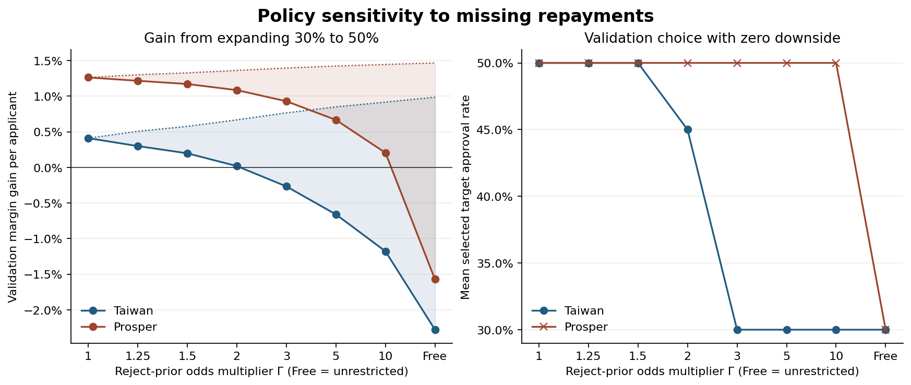

# How far can a lender expand when outcomes of rejected cases are unknown?

## Decisions fixed for the extension

This exploratory extension was designed after the original public-cohort results had been seen. Before computing the new sensitivity curves we fixed a 30% baseline target, 35%, 40%, 45% and 50% candidates, a 10% interest rate and 50% loss given default. Validation sets both the numerical cutoffs and the choice among them. Reuse the original model inputs, fits and test partitions. The two tolerated downside levels are 0 and 0.0025 units of margin per applicant on unit principal. The prespecified sensitivity factors are 1, 1.25, 1.5, 2, 3, 5, 10 and unrestricted. Select the highest prior-mean gain among qualifying policies, breaking ties in favor of the smaller target. Inspect the fully observed test outcomes after freezing every numerical cutoff.

## What the bounds measure

Write $a_i$ and $b_i$ for the candidate and baseline approval decisions. For a unit loan, let $r=0.10$ be interest and $c=(1+r)LGD=0.55$. If the borrower defaults ($Y_i=1$), the margin falls by $c$. Averaged over *all* applicants, the gain from changing policies is

$$
\Delta=N^{-1}\sum_i (a_i-b_i)(r-cY_i).
$$

Applicants approved by both policies cancel exactly, even when their outcome is unknown. In an expansion, only newly approved applicants affect the sign. In a more general substitution, removal of a bad loan improves the gain, whereas adding one worsens it. Bounding the two margins independently and subtracting their extremes can put inconsistent repayments on the same shared borrower.

**Unrestricted binary outcomes.** Keep each known repayment fixed. For missing cases, minimize or maximize the linear expression by choosing 0 or 1 separately according to the sign of its coefficient. Both endpoints are attainable on this finite cohort. For ABR, the denominator is the fixed count approved. The two numerators are known approved defaults and known approved defaults plus the number of missing approved outcomes. With zero approvals the ABR is undefined and margin is zero. This is the classical missing-outcome partial identification argument applied to the paper's policy problem. [Manski, *Partial identification with missing data*](https://doi.org/10.1016/j.ijar.2004.10.006)

**Prior sensitivity.** For each missing outcome let $p_i$ be the accepts-trained prior probability, and $q_i$ its unknown true probability. At finite Γ assume the odds of $q_i$ lie between $1/Γ$ and Γ times the odds of $p_i$. This odds-ratio bound follows the sensitivity models of Rosenbaum (2002, *Observational Studies*) and Tan (2006, *JASA* 101(476)), applied here to the missing outcome rather than to treatment assignment. Apply each case's lower and upper probability at the proper sign of its coefficient. The resulting bounds are sharp for the **conditional expected** ABR and value, given the observed cases, fixed monetary assumptions and individual probability intervals. Dependence among outcomes does not affect the mean. At Γ=1 the range collapses to the prior mean. Individual binary realizations can fall outside a finite-Γ interval even when the assumed probabilities are correct. Γ=∞ drops the prior and yields the unrestricted binary extremes. Fitted reference probabilities are clipped to [10⁻⁸, 1−10⁻⁸] for finite odds.

The two datasets already contain financed borrowers. Historical masking is simulated under MAR with known propensities. This exercise asks what the decision can withstand if we decline to use MAR identification and instead supply a range of plausible reject risks. Γ bounds departure from the reference **outcome odds**. It does not measure how strongly the bank selects on an unobserved outcome. Neither this parameter nor the eventual performance of real rejected applicants is identified by these public data.

## Validation decision and test audit

For each locked candidate target, compute the inverse-empirical-CDF cutoff on its validation cohort and issue at scores at or below that cutoff. Tied scores can change the effective issued fraction. Fit XGBoost and the logistic prior on the same accepted fitting labels used for the main experiment. A candidate qualifies if its worst paired margin change on validation is at least the negative of the downside budget. Among qualifying candidates choose the largest expected gain under the reference prior. The unchanged 30% policy always qualifies. Apply the numerical cutoffs unchanged to test applicants and reveal the actual outcomes for audit. Finite-Γ validation constraints provide no guaranteed future-cohort protection against drift, sampling variation or incorrect model assumptions.

| Validation rule (zero downside) | Taiwan, four-fold mean | Prosper, later test cohort |
|---|---:|---:|
| Target at Γ=1 | 50% | 50% |
| Target at Γ=2 | 45% | 50% |
| Target at Γ=3 | 30% | 50% |
| Target with fully unrestricted outcomes | 30% | 30% |
| Largest Γ supporting 30% to 50% | 1.85–2.30 across folds | 13.19 |
| Realized test gain of 30% to 50% | +0.608 pp per applicant | +1.627 pp per applicant |

The 45% Taiwan entry averages one 30% decision and three 50% decisions. Under unrestricted outcomes, the validation range for 30% to 50% is **−2.279 to +0.987 pp** on Taiwan (mean of the four fold endpoints) and **−1.572 to +1.468 pp** on Prosper. The positive realized gains were unavailable when choosing the policies. They compare a fixed 30% baseline with a 50% expansion. In the main experiment two different evaluators selected the same cutoff at base LGD and their gain relative to each other was zero.

On Prosper, allowing a downside of 0.25 pp makes a 35% validation target admissible even without a prior. Its unrestricted validation downside is 0.240 pp; the frozen cutoff later produced a realized gain of 0.356 pp. These are scenario margins on unit principal, excluding operational costs and population-wide changes in credit supply. They are not causal estimates for unfunded applicants.

The shaded areas are the lower and upper identification endpoints for a fixed 30% to 50% expansion. The curves for Taiwan average across the four folds. Tipping radii are solved separately for each fold on a continuous log-Γ scale. A missing radius means that the prior point itself fails the downside test. An infinite radius means the unrestricted bound is sufficient for the observed experimental cases.

## Reproduce and inspect

Run `PYTHONPATH=src python -m paper11.bounds_experiment --cache data/cache --out results` with the pinned environment. The run emits the [validation frontier](../results/bounds_frontier.csv), [tipping radii](../results/bounds_tipping.csv), [frozen rule and test outcomes](../results/bounds_policy.csv), [cohort summaries](../results/bounds_summary.csv) and the chart above. Each margin and rate in the CSV files is a fraction. Multiply margin differences by 100 to obtain percentage points of one unit of principal per applicant.

[Tests](../tests/test_bounds.py) enumerate all binary completions of a tiny sample, independently enumerate all corners at finite Γ, recover an analytic tipping radius of exactly 2, exercise sign-changing policy moves, verify cancellation with identical policies and confirm that changing test repayments leaves the locked policy intact. The runner checks every realized test gain against the test cohort's own unrestricted binary endpoints.
