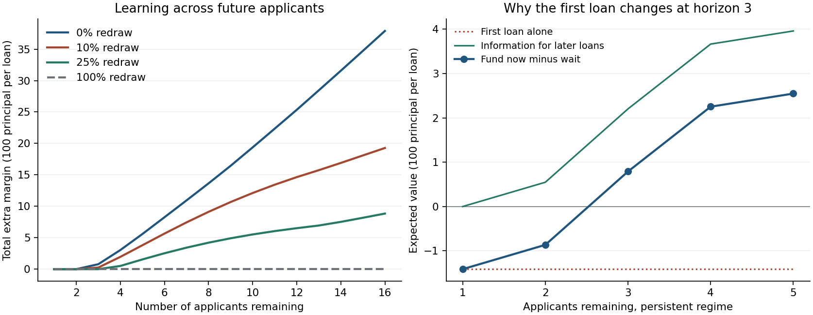

# When does it pay to make a loan in order to learn?

Suppose a lender faces three marginal applicants in succession. Each loan has principal 100. On its own, the first loan loses **1.4125** in expectation. If its repayment arrives before the lender must decide on the second applicant, that information is worth **2.2028** across the remaining opportunities. The lender should issue the first loan. With only two applicants left, the same experiment's information is worth **0.5481** and the lender should decline. These are exact expectations in a two-regime thought experiment.

## How the two worlds generate the same archive

The old policy always declined marginal applicants. Existing funded borrowers have the same feature and repayment law in both worlds. Marginal arrivals have the same observed features and decisions in both worlds, and produce no historical repayment labels. Thus every visible history has the **same likelihood** under either marginal-risk regime. Its length does not update the odds. We set the probability of the low-risk regime to 0.55 as a scenario input. The first marginal loan changes what the lender observes.

| Marginal pool regime | Prior probability | Loan default probability | Expected margin per unit-principal loan |
|---|---:|---:|---:|
| Lower risk, G | 0.55 | 0.05 | +0.0725 |
| Higher risk, B | 0.45 | 0.40 | −0.1200 |

A repaid unit loan earns 0.10 and a defaulted unit loan loses 0.45, as in the project's 10%-interest, 50%-LGD scenario. If the lender declines, it receives zero and sees no outcome. A funded loan reveals its binary repayment before the next decision. Applicants are independent conditional on their current regime. Initially one regime is shared across applicants. After each period the state persists with probability $1-\lambda$. With probability $\lambda$ it is redrawn from the original 0.55/0.45 mixture. This event is invisible to the lender and independent of its action. At $\lambda=1$ each applicant's regime is a fresh independent draw.

## The calculation a lender can do by hand

Let $b=P(G\mid\text{visible history})$. Default probability is $d(b)=0.05b+0.40(1-b)$ and the current expected loan margin is $m(b)=0.10-0.55d(b)$. The outcome updates the current-state belief to $b_D=0.05b/d(b)$ after default or $b_R=0.95b/[1-d(b)]$ after repayment. Advance any updated belief to the next period with $T(b)=(1-\lambda)b+0.55\lambda$.

For $h$ remaining arrivals, with $V_0=0$,

$$
\begin{aligned}
Q_{\mathrm{fund}}(h,b)&=m(b)+d(b)V_{h-1}(T(b_D))+[1-d(b)]V_{h-1}(T(b_R)),\\
Q_{\mathrm{wait}}(h,b)&=V_{h-1}(T(b)),\\
V_h(b)&=\max\{0,Q_{\mathrm{wait}}(h,b),Q_{\mathrm{fund}}(h,b)\}.
\end{aligned}
$$

Stopping permanently gives zero. Waiting declines this applicant and preserves the right to act on future ones. The observation arrives after funding. The lender must choose the first action before taking either outcome branch. If both continuation choices have zero value, the implementation records a permanent stop. It prefers waiting at a positive tie.

With persistent risk and three applicants, the first loan defaults with probability 0.2075. That puts $P(G)=11/83=0.13253$ and the best remaining strategy has value zero. Repayment has probability 0.7925, puts $P(G)=209/317=0.65931$, and makes the remaining two decisions worth 0.02779614 together. Waiting initially earns no signal and leaves the less attractive two-arrival problem.

$$
Q_{\mathrm{fund}}(3,0.55)=-0.014125+0.2075(0)+0.7925(0.02779614)=0.0079034375.
$$

The gross value of the first signal is 0.0220284375 units of principal. The **net gain of funding now instead of waiting** is 0.0079034375. That smaller amount is the highest extra one-off fee the lender could pay on its first loan before waiting becomes equally attractive under a fee charged only on the first loan. The best fixed policy earns zero, and issuing all three loans would earn −0.042375. A lender told each current regime in advance would earn 0.119625 over these three arrivals. This oracle still faces uncertainty about each individual repayment.

## How long does the information last?

The table counts opportunities in discrete time and reports **total expected margin over ten arrivals**. Each issued loan has unit principal. The fixed lender can choose any schedule in advance. Because the regime begins at its stationary mixture, every possible funding date has the same negative unconditional margin and the best such schedule declines all. The oracle sees the current regime before every decision and issues only in G.

| Unobserved redraw probability after each arrival | First horizon with initial funding | Best fixed, H=10 | Adaptive, H=10 | Current-regime oracle, H=10 |
|---|---:|---:|---:|---:|
| 0% | 3 | 0 | 0.193698 | 0.398750 |
| 10% | 3 | 0 | 0.121121 | 0.398750 |
| 25% | 4 | 0 | 0.055202 | 0.398750 |
| 50% | None through 16 | 0 | 0 | 0.398750 |
| 100% | None at any horizon | 0 | 0 | 0.398750 |

With 25% redraw probability and sixteen arrivals, a first default leads to **wait** on the second applicant while preserving 0.023005 in expected future margin. Time can move a pessimistic belief toward the unconditional prior even while no loans are issued. After a first repayment the lender funds again. With 100% redraw probability the next belief is exactly 0.55 for every outcome. The funded signal has zero continuation value at every horizon, by induction in the recursion.



## Interpretation and assumptions

The [historical minimax comparison](identification.md) asks which cutoff has the smallest worst loss over fixed completions of a real masked cohort. This section poses a different decision. A lender assigns probabilities to two future regimes, changes which labels it observes, updates after each actual funded outcome and maximizes expected cumulative margin. The [sequential audit](decision-audit.md) concerns evidence about a fixed historical population, with a design-based error guarantee. This example values the consequences of learning across future loans under a specified probability model.

The numerical results assume these default probabilities, regime prior, persistence, one-period repayment feedback, full take-up and the stated margins. There is no discounting, capital constraint or extra data-acquisition cost. The project has no estimate of these model parameters for an actual pool of rejected applicants. Delayed repayment can leave future decisions unable to use the information on this schedule. A bank would need evidence about timing and transfer across applicants before adopting this policy.

Wei studied online decisions under selective labels and the trade-off between learning costs and future utility. Our contribution here is a reproducible teaching calculation tracing one initially negative loan through its repayment branches and an unobserved regime reset. The finite-horizon belief-state recursion uses the established piecewise-linear representation of partially observed Markov decision problems. [Wei, ICML 2021](https://proceedings.mlr.press/v139/wei21a.html) · [Smallwood and Sondik, *Operations Research*, 1973](https://doi.org/10.1287/opre.21.5.1071)

## Reproduction and checks

```sh
PYTHONPATH=src .venv/bin/python -m paper11.exploration --out results
PYTHONPATH=src .venv/bin/pytest -q tests/test_exploration.py
```

The [action values](../results/exploration_values.csv) cover all horizons 1–16 and five redraw probabilities. The [two conditional branches](../results/exploration_branches.csv) show what would happen **if the first application were funded**, including rows in which the lender optimally stops. A terminal branch is marked `end`.

The [solver](../src/paper11/exploration.py) stores expected payoff conditional on each of the two regimes for each active policy tree. Its expected payoff is affine in the current belief. Backward induction finds the exact interval boundaries at which the next preferred tree changes, evaluates both outcome branches there and takes the upper envelope of the resulting policy payoffs. This uses floating-point arithmetic, with no belief grid, simulation, or interpolation of fitted values. The [tests](../tests/test_exploration.py) compare it to an independent enumeration of small observable histories in exact rational arithmetic. They also check the analytic three-arrival example, full refresh, identical regimes, perfect and impossible signals, permanent stopping and strictly beneficial waiting.
