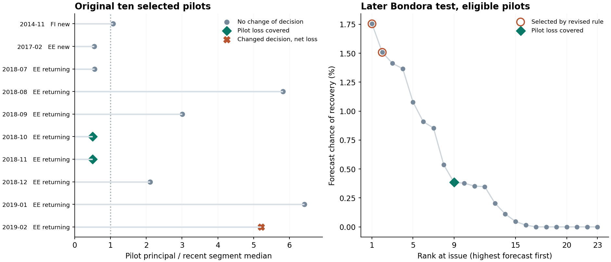
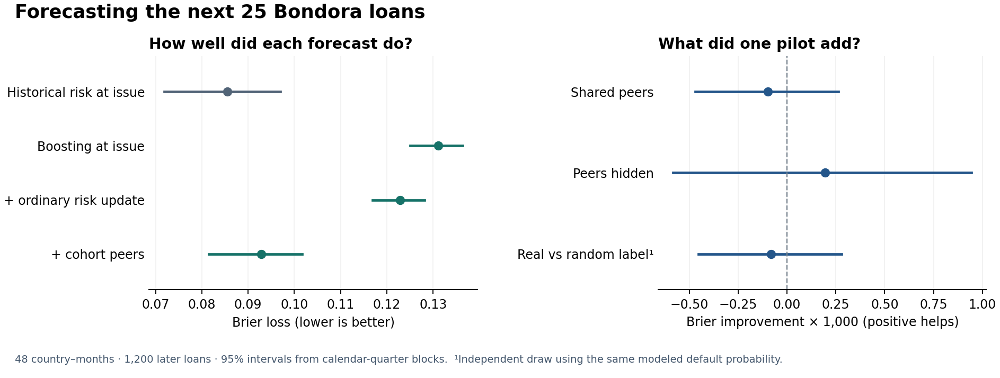
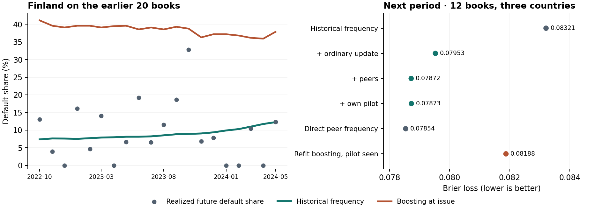
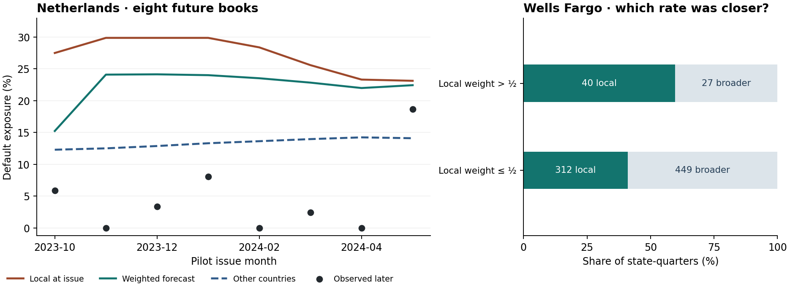

# Research extensions and case evidence

Detailed comparisons supporting the three findings in the [project overview](../README.md). The newest [early-payment analysis](early-warning.md) includes the Dutch warning and the independent Czech test.

## When can a pilot loan pay for information?

**Issue an otherwise loss-making pilot only if its expected loss is less than the discounted improvement in future decisions that its repayment reveals.** The comparison bank gets the ordinary risk updates it would receive even if it skipped the pilot. A change in estimated risk has value only when it can change an action that affects the margin.

In a stable illustrative regime, a pilot of 100 costs 1.4125 in expectation and adds 0.548125 per subsequent loan. Three later decisions cover that cost. If an independent regime replaces the old one with 10% probability per arrival, all future decisions together can be worth at most 0.70889. With heterogeneous borrowers, their marginal default risks alone can sometimes rule out funding the pilot under *every* possible dependence structure. The proof, independent numerical checks and a sequential model distinguish buying one signal from learning after every loan. [Break-even condition](information-value.md) · [Sharp dependence bounds](pilot-dependence.md) · [Sequential learning](exploration.md)

### Two Estonian pilots and a counterexample

The old rule selected ten of 228 initially loss-making pilot opportunities in an expanded Bondora sample. Three replayed decisions changed. Two pilots recovered a direct loss through the later decision. Both were €530, half the recent median in their segment, on 36-month contracts with five previous loans. The other eight selected pilots had a median principal of €3,092.50.

| Returning Estonian customers | Principal / recent segment median | Subsequent decision in the replay | Net cash difference by 24 May 2024 |
|---|---:|---|---:|
| July 2018 | €530 / €955 | Unchanged | +€93.96, all from the pilot |
| October 2018 | €530 / €1,060 | Lend → decline | +€15,944.29 |
| November 2018 | €530 / €1,060 | Lend → decline | +€8,706.30 |
| February 2019 | €5,525 / €1,060 | Lend → decline | −€8,672.42 |

October's pilot lost €267. The next 25 loans had returned €16,211.29 less than principal including interest and penalties, so declining them in the replay covered the loss. Bondora funded all those loans. Later collections can change the measured gain. July shows why a small pilot is insufficient by itself. February shows how the same change in action can lose money. [All ten profiles and comparison groups](pilot-profiles.md) · [Paired cash ledgers and collections risk](lender-pilot.md)

Information access matters. If the bank gives past cohorts twice as much weight, **all three switches disappear**. They also disappear when both banks observe the other matured loans from the pilot's own cohort. This calculation keeps the same ten pilot choices and the same receipts. The ledger measures what borrowers paid. The modeled access to a useful private signal determines whether those receipts imply a gain from changing policy. [Signal-weight and peer-information sensitivity](pilot-signal-sensitivity.md)

### Predicting recovery on untouched dates

The revised rule prices the pilot at its offered principal, forecasts the next portfolio's size from the preceding twelve months and allows for ordinary risk updates before the pilot matures. It never screens for Estonia, €530 or a particular borrowing history. We locked the formula, endpoints, follow-up horizon and data definitions in public commits before scoring the new cohorts. The independent-period test uses a later Bondora workbook with country and risk grade at issue. These are two time windows on the same platform. [Frozen rule](https://github.com/bigpurota/paper11/commit/0fda6dd) · [Frozen cohorts and cash definitions](https://github.com/bigpurota/paper11/commit/9110afd) · [Provider](https://goandgrow.eu/en/public-statistics/)

| Frozen test | Eligible opportunities | Pilots old → new | Strict cash recoveries found / available | New vs. skipping per eligible |
|---|---:|---:|---:|---:|
| Bondora, June–September 2024 | 0 | — | — | Unmeasurable |
| Bondora, July 2020–September 2022 | 23 | 0 → 2 | 0 / 1 | +€10.86 [€0.00, €21.41] |
| US Prosper, January 2008–January 2012 | 30 | 0 → 0 | 0 / 0 | $0.00 |

The primary window had 62,903 funded loans in 119 country–grade–month cells. Every loan carried a named grade; all 86,344 loans in the required historical window were unrated. There was no same-grade history to estimate risk on any of the 119 cells. The longer-seasoned panel supplied one strict cash recovery. A €1,141 Finnish pilot in March 2021 lost €386.82. Its default would have led the rule to decline 25 loans whose recorded cash shortfall was €4,103.74, leaving **+€3,716.92** after the pilot loss. Both rules passed on it. The two loans that the revised rule did select earned €249.80 in total, entirely from the pilots themselves. [Dates, cash, exposure and missingness](pilot-holdout.md)

The **funding rule** and the **score for finding strict recoveries** answer different questions. The Finnish case ranked ninth of 23 at issue. The pooled ranking AUC was 0.636 [0.533, 1.000], clearing the prespecified 0.5 lower-bound criterion among the 1,810 of 2,500 resamples containing both outcomes. Within Finland the single success beat seven of fifteen negatives (AUC 0.467). In development the revised funding rule had kept both winners and the February loss, recommending 17 pilots to the old rule's ten. These observations do not establish dependable selection or a positive incremental cash gain on new loans. [Rank, coverage, ablations and paired intervals](../results/pilot_rule_summary.csv)

For a **different lender**, we then locked a supplementary test on Prosper before computing its pilot outcomes. The archive was already used for other scorecard experiments. Of 31,947 funded loans in the origination window, 293 group–months had adequate history and 30 had a forecast direct loss. Neither rule lent in those 30. Three contingent decisions changed sign where the next group had zero borrowers. No strict cash recovery occurred, even when every eligible pilot was tried. [Prosper test and source accounting](pilot-prosper.md) · [Public protocol](https://github.com/bigpurota/paper11/commit/11bf82d)

### What does the bank learn from one particular loan?

Before the March 2021 Finnish pilot, the amount-aware rule expected a direct loss of €86.93 and priced the information at €6.73. In November 2021 and February 2022 it forecast smaller direct losses, more future lending, and positive net values of €9.80 and €24.18. By the time the March outcome arrived, ordinary news had put estimated risk at 16.47%. Its default moved that estimate past the 18.18% break-even threshold to 20.45%. If both banks could already see the 473 other loan outcomes from the same cohort, the identical default moved risk from 7.36% to 7.55%. Both would continue lending. The archive records the loan outcomes. The information available to the two banks is an explicit assumption. [Three decision reconstructions](finnish-pilot-cases.md)

We then froze a small gradient-boosting model and asked it to forecast the next 25 loans twice. With the pilot hidden, the lender averages the two possible outcomes. With it revealed, it uses the corresponding branch of the **same fitted model**. The October 2022–May 2024 test supplied 48 nonempty country–month portfolios and 1,200 subsequent loans. Adding the cohort's other outcomes improved boosting's Brier loss by 0.03002. Revealing the pilot itself gave **−0.000097** improvement (95% calendar-block interval −0.000469 to +0.000262). The simple historical risk estimate had the lowest average loss among these comparisons. [Dated protocol](https://github.com/bigpurota/paper11/commit/dc96e5e) · [Forecast comparisons and controls](pilot-signal-ml.md)

Of 19 initially loss-making opportunities, the model predicted a positive information gain in bits on all 19. In every case, the possible updates stayed on the same side of the lending threshold across all historical scenarios. The ML rule funded zero, compared with two under the previous selector. The resulting €529.78 improvement in recorded cash across episodes came entirely from avoiding a direct pilot loss. Just eight of the 19 opportunities had a nonempty continuation, all in the Netherlands, which was absent from training. This test found no pilot whose signal paid for a loss. [Sample and overlap](pilot-signal-panel.md) · [All gains and intervals](../results/pilot_signal_ml_metrics.csv)

### Why did the frequency beat boosting, and can its updates improve a decision?

In the earlier test the historical rate used a median of 28,603 measured loans per forecast. Boosting learned on 232 country–month portfolios, and having the frequency as an input did not make its prediction follow the new level of risk. In Finland the rate averaged **8.90%** against **9.24%** realized future default exposure. Boosting at issue averaged **38.44%**. All 20 Finnish test frequencies lay below the Finnish training range. Across all 48 books, 82.8% of the Brier gap at issue came from the models' different mean errors. [Error decomposition and model-input experiment](frequency_diagnosis.md)

We anchored the forecast to the historical rate and let the model learn only the updates from ordinary news, peer repayments and the pilot. On the next **12 country–month portfolios, 300 new subsequent loans**, Brier loss fell from **0.083211** at issue to **0.078720** with common news. Revealing the pilot moved it to **0.078726**. The direct pooled peer frequency scored **0.078538**, the best result on these dates. The Dutch June portfolio crossed the lending threshold on the ordinary risk update. No pilot outcome changed an action. The four-month window contains one initially loss-making opportunity and no pilot default in either candidate sample. [Protocol committed before scoring](https://github.com/bigpurota/paper11/commit/fff202a) · [Fresh test and Dutch cash flows](frequency-test.md)

### When should a lender trust its local history?

The Dutch local forecast averaged **27.19%** against **4.79%** realized default exposure. Three consecutive forecasts still used the same 73 first-year defaults among 245 loans from the first two months of the market. Bondora paused Dutch origination for further testing and reopened in January 2023. Before the eight forecasts, recent issuance was already 11 to 71 times the volume in the mature history. Across the full later Dutch vintages there were 687 defaults among 16,621 loans. Holding contract term and loan-size mix at their early proportions still gives a later default rate of 4.60%. In seven of the eight portfolios the observed rate fell below both forecasts. Even weights chosen with hindsight leave at least 9.14 percentage points of mean absolute error. [The Dutch vintages, sampling and dated announcements](dutch-frequency.md)

Our rule balances estimated variation between other markets against uncertainty in the local rate, with a discount for rapid expansion. In the known Dutch cases it forecast 22.29%; the broader rate alone gave 13.36%. In a separate test we applied the fixed rule to Wells Fargo SBA 7(a) loans in 2015–2019. Across **828 state–quarters and 23,849 loans**, the hybrid reduced Brier loss by 0.001684 relative to local (95% block interval +0.001131 to +0.002142) and by 0.000014 relative to the rest of the bank (−0.000005 to +0.000046). The hard selector identified the closer rate in 489 of 828 state–quarters; always using the other states was correct in 476. All 67 local-majority calls fell in the final six quarters. Both the hybrid and the outside-state rate implied the same lending actions under the two stated payoff scenarios. [Protocol published before scoring](https://github.com/bigpurota/paper11/commit/99db60b) · [Trust condition](local-trust.md) · [External lender results](local-trust-bank.md)

### What other lenders can establish

* **US SBA 504.** The fixed rule selected three of 79 initially loss-making region-quarters. All three subsequent actions stayed the same after the ordinary public update. The scenario gain per eligible episode was −0.022 (95% block interval −0.076 to +0.005), on loans of principal 100. [Dates, controls and assumptions](pilot-replay.md)
* **US SBA 7(a).** The archive supplied 886,287 eligible historical disbursements. On the local pricing specification, the rule selected 16 of 85 loss-making opportunities. Four follow-up decisions changed. Its AUC for positive total scenario margin was 0.416 [0.206, 0.624]. A positive total can come from repayment of the pilot alone. [Borrower draws and observed write-offs](pilot-transfer.md) · [Forecasts and uncertainty](pilot-targeting.md)
* **Commercial Bank of Africa.** Knowledge from project TOBOA informed a documented revision to the M-Shwari scorecard. Reported acceptance rose from 40% to 47%. The case study gives no incremental cash profit attributable to the change. [Field evidence and primary sources](observed-pilot-evidence.md)

## What to measure when outcomes are missing

| Question | Finding |
|---|---|
| Which information recovers the margin difference between every pair of five nested cutoff policies? | Four adjacent-band margin totals suffice. Under independently variable band margins, four independent linear measurements are necessary for all exact differences. Choosing a winner may take fewer. [Proof and 50 numerical checks](policy-information.md) |
| Are actual default counts in ten risk groups enough? | Two completions of one Taiwan sample match all observed outcomes and all ten group counts, yet the 30%→50% expansion earns +0.900 or −0.888 percentage points per applicant. The Prosper group counts settle the sign. [Counterexamples and minimax regret](identification.md) |
| How many hidden repayments settle one choice? | On Prosper, auditing a random subset needs 14.46 of 160 labels on average with the observed default count, or about 153 near break-even. The finite-population wrong-sign bound is 5%. [Sequential audit](decision-audit.md) |
| Does better historical measurement improve forecasts? | Across twelve Prosper quarters the Bayesian correction reduces historical RMSE from 0.79 to 0.26 pp, while next-quarter forecast RMSE rises from 2.08 to 2.36 pp. [Calendar forecasts](vintages.md) |
| How sensitive is a cutoff to missing outcomes? | The 30%→50% expansion keeps nonnegative worst-case conditional expected margin up to reject-odds multipliers of 1.85–2.30 across Taiwan splits and 13.19 on Prosper. [Policy bounds](bounds.md) |
| What does randomized access establish? | In the Philippine experiment, extending offers to both score windows adds 8.02 pp in funding and 4.19 PPP dollars in cash margin per applicant before costs. The extract covers 1,113 marginal applicants. [Trial and cash-flow accounting](rct.md) |
| Where should an audit spend 50 labels? | On Taiwan, drawing inside the candidate portfolio reduces bad-rate estimation RMSE from 2.01 to 0.86 pp relative to drawing from all rejects. [Equal-budget comparison](../results/audit_summary.csv) |
