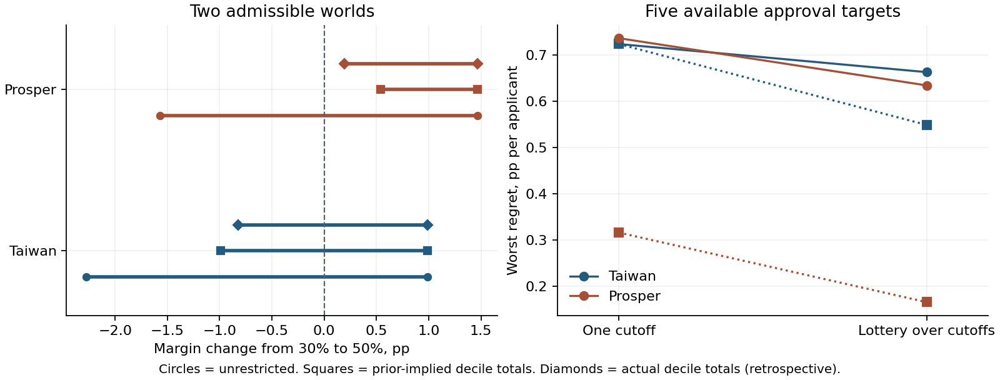

# Can two lenders see the same history and need opposite policies?

On Taiwan's first validation fold, a lender sees 3,825 repayments. Exactly 691 defaulted. Two possible completions agree on every one of those observations, every applicant's features, the historical decision and score. They even agree with the **actual** number of hidden defaults in each of ten bands of the lender's predicted risk, as revealed by a retrospective audit of the masked population. Yet raising the approval target from 30% to 50% earns margin in one completion and loses margin in the other.

| Taiwan, first validation fold | Fewer defaults among new approvals | More defaults among new approvals |
|---|---:|---:|
| All applicants / originally approved | 6,000 / 3,825 | 6,000 / 3,825 |
| Observed defaults | 691 | 691 |
| Hidden defaults | 699 | 699 |
| Hidden defaults in prior deciles, low to high | 21, 34, 37, 27, 27, 51, 79, 118, 146, 159 | same |
| Newly approved under the expansion | 1,200 | 1,200 |
| Originally hidden among newly approved | 350 | 350 |
| Defaults among all newly approved | 120 | 315 |
| Incremental margin per applicant | **+0.900 pp** | **−0.888 pp** |
| Better of the two targets | **50%** | **30%** |

For a loan of unit principal, the performing margin is 0.10 and the default margin is −0.45. Thus the expansion earns money if fewer than $0.10(1{,}200)/0.55=218.18$ new borrowers default. Moving otherwise invisible defaults between applicants on opposite sides of a cutoff reverses the answer while keeping all ten totals fixed.

## Recalculate the bounds from ten rows

The [decile counts](../results/identification_deciles.csv) contain ten rows per validation fold. A *switcher* is someone admitted at the 50% target who would have been declined at 30%. In decile $b$, let $M_b$ be the number of hidden applicants, $m_b$ the number of hidden switchers, and $K_b$ the actual number of hidden defaults disclosed by the oracle. If $x_b$ of those defaults belong to switchers, the sharp limits are

$$
\max\{0,K_b-(M_b-m_b)\}\ \le x_b\le\ \min\{m_b,K_b\}.
$$

There are only $M_b-m_b$ places outside the expansion band to put defaults. Any overflow must go to switchers. At the other extreme, at most $m_b$ switchers can default and only $K_b$ defaults exist. Filling the places on either side in that order attains both limits. The ten groups are disjoint, so their ten minima and their ten maxima can each be attained simultaneously.

In Excel, filter to one dataset and fold. Sum `min_hidden_switcher_defaults` and `max_hidden_switcher_defaults` separately, then add `known_switcher_defaults_fold` **once** to each sum. On Taiwan fold 1 this yields $120 + 0 = 120$ and $120 + 195 = 315$. Using $B=1{,}200$ switchers, $N=6{,}000$ applicants and $d$ defaults, either margin is $(0.10B-0.55d)/N$. The larger default count gives the lower margin. The three `_fold` columns repeat their values to support spreadsheet filtering.

## What each experiment assumes

The [partial-identification analysis](bounds.md) asks how much downside is possible if the policy changes and how much the reference odds must be trusted before an expansion qualifies. Here the lender must choose among several actions and cares about the opportunity cost of choosing a suboptimal one. A safe incumbent can still forgo attractive loans. We compare the strategy that minimizes that maximum opportunity cost, with and without allowing a lottery over policies. This exploratory decision analysis was designed after the underlying cohort results were available. The five targets and the economic scenario are inherited unchanged from the earlier experiment.

* **Unrestricted history.** Keep every known outcome. A missing borrower can have either binary outcome. Terms, exposure and recovery are fixed, and borrowers' repayment responses to otherwise identical loans are stable across the candidate policies.
* **Ten prior-implied exact counts.** Rank the historically rejected validation cases by the frozen, accepts-trained logistic prior. Divide ranks into ten approximately equal groups, using original order to break ties. Fix the number of defaults in group $b$ at $K_b=\lfloor\sum_{i\in b}p_i + 0.5\rfloor$. Every completion in this scenario satisfies these ten integer totals. This is a deliberate thought experiment about perfect information on group averages. The counts come from rounding the prior, before consulting any hidden label. The data do not establish that these are the true totals.
* **Ten actual counts, retrospective information only.** After freezing the previous policies, an oracle tabulates the actual rejected defaults in those same ten prior-risk groups. A separate 30% versus 50% comparison sees only these aggregate counts. Individual missing labels never enter its optimization. The released outputs mark this row `oracle_audit_only=True`. Both extremal completions agree with the actual counts.
* **Audit on later or separate borrowers.** Fit the established accepted-only scorecard and compute numerical cutoffs on validation. Lock every cutoff and lottery weight before looking at test repayments. The reported test margins use the observed realized repayments of these previously financed public cohorts. For Taiwan, average within-fold results equally. Prosper has one later test cohort.

The two completions are observationally equivalent conditional on this finite masked history and the information the analyst permits. We deliberately suppress the historical MAR and overlap assumptions used to generate the public masks. In a population with valid MAR and overlap, accepted responses can identify conditional mean risk from the observed-data law. This finite-sample construction demonstrates what an analyst can conclude without that identifying restriction. Both modeled histories come from datasets of previously funded borrowers.

## The game and its solution

Let $a_{ji}$ indicate approval of applicant $i$ under cutoff $j$, and $V_j(y)=N^{-1}\sum_i a_{ji}(0.10-0.55y_i)$. The lender chooses mixture weights $w_j\geq0$ with $\sum_j w_j=1$. Nature chooses a single admissible completion $y$, without observing the realized random action. The comparison policy sees $y$ and picks its best cutoff on the same grid. The resulting maximum regret is

$$
R(w)=\max_y\max_k\left\{V_k(y)-\sum_jw_j V_j(y)\right\}.
$$

Shared loans cancel before evaluating regret. The quantity averages over the policy lottery and measures unit-principal margin per applicant. A single realized lottery can lose more. A lender that must use one deterministic cutoff can minimize over the five pure actions instead.

**Why five worlds suffice.** For fixed comparator $k$, the coefficient of $y_i$ has the sign of $h_i(w)=\sum_j w_j a_{ji}-a_{ki}$. If $a_{ki}=0$, $h_i\geq0$ for every mixture. If $a_{ki}=1$, $h_i\leq0$. Thus a single binary completion simultaneously maximizes the comparator's advantage against every competing action on the unrestricted outcome space. This argument also permits crossing, non-nested policies.

With a fixed count in a stratum, the worst case assigns its $K_b$ defaults to the rows with the largest $h_i(w)$. For nested cutoffs, write $t_i$ for the first policy admitting borrower $i$. Then $\sum_jw_j a_{ji}=\sum_{j\geq t_i}w_j$, which decreases with $t_i$. Borrowers rejected by comparator $k$ have nonnegative priority and those accepted by it have nonpositive priority. Within either group, earlier entry gives higher priority. The ordering for a uniform mixture therefore remains a valid ordering for every other mixture, with possible extra ties. Applying this ordering separately in each stratum produces a common extremal state $y^{(k)}$. Crossing policies with fixed counts would require a different algorithm.

Construct $G_{kj}=V_k(y^{(k)})-V_j(y^{(k)})$. The deterministic answer minimizes $\max_k G_{kj}$ over $j$. The lottery solves the linear program $\min_{w,t}t$ subject to $Gw\leq t\mathbf{1}$ and $w$ lying in the probability simplex. Each row uses one jointly attainable completion for every action. The comparator label $k$ indexes the maximized payoff difference. Another action may beat $k$ in that witness if $k$ is dominated. [Manski, *Minimax-regret treatment choice with missing outcome data*](https://doi.org/10.1016/j.jeconom.2006.06.006) · [Stoye, *Minimax regret treatment choice with incomplete data and many treatments*](https://doi.org/10.1017/S0266466607070089)

**Two-action check.** Let $[L,U]$ be the sharp range of the expansion gain over keeping the incumbent. When $L<0<U$, an expansion with probability $q$ risks regret $-qL$ in the adverse world and $(1-q)U$ in the favorable one. Equalizing gives $q=U/(U-L)$ and worst regret $-LU/(U-L)$. If the gain always has one sign, the corresponding pure action has zero regret. The numerical solver matches the closed form on the 30% versus 50% grid.

## Results across both cohorts

All gains and regret values below are percentage points of margin on unit principal per applicant. Taiwan's endpoints are averages across its four folds. In every single Taiwan fold the two signs remain possible under either source of the ten counts.

| Validation cohort and information | Sharp gain, 30% to 50% | Pure minimax target, five actions | Worst regret, pure | Worst regret, lottery |
|---|---:|---:|---:|---:|
| Taiwan, unrestricted | −2.279 to +0.987 | 35% | 0.723 | 0.662 |
| Taiwan, prior-implied counts | −0.993 to +0.987 | 35% | 0.723 | 0.549 |
| Prosper, unrestricted | −1.572 to +1.468 | 40% | 0.736 | 0.634 |
| Prosper, prior-implied counts | +0.537 to +1.468 | 50% | 0.316 | 0.166 |

**With the ten actual retrospective totals**, the two-action gain interval is **−0.821 to +0.987 pp in Taiwan** and **+0.195 to +1.468 pp on Prosper**. Thus the real aggregates leave the policy choice unidentified in Taiwan and determine it on this Prosper validation cohort. The holdout audit remains distinct from information available to the lender at the time of underwriting.

On Prosper, knowing the hypothetical ten totals is strong enough to justify 50% over 30% in every admissible world. The five-action game still has positive regret because the intermediate 45% cutoff can outperform 50%. The optimal lottery gives 47.53% weight to the 45% target and 52.47% to the 50% target. Compare actions in a game with the same comparator set when interpreting regret.

On the unrestricted **two-action** grid, the expansion probabilities are 30.21% for Taiwan (mean) and 48.30% for Prosper. With all five choices, the unrestricted least-regret pure target is 35% in all four Taiwan folds and 40% on Prosper. Observed test gains over 30% for those deterministic choices were +0.204 and +0.758 pp. Integrating over the corresponding five-cutoff lotteries gives +0.217 and +0.870 pp. These test figures compare modeled cash flows on a separate set of already financed borrowers. The validation guarantee applies only to the finite validation game.



## What is one exact decision-relevant statistic worth?

For 30% versus 50%, learning the total number of defaults in the expansion band determines the winner. For five cutoffs, the four incremental band totals determine all payoff differences. Under unrestricted outcomes we also evaluate a smaller signal. Before seeing any more outcomes, choose **one** adjacent band and suppose its exact hidden-default count becomes available. For each possible integer count, update the minimax lottery; take the largest resulting regret across the possible counts. The reduction from the original minimax regret is the ex-ante worst-case value of this signal in this decision problem.

On Prosper the strongest single band is 40–45%, containing 39 hidden borrowers. Learning its exact total reduces worst regret from 0.634 to 0.454 pp. On Taiwan, learning the 30–35% band's total reduces it by 0.173 pp on average; 35–40% is the more valuable band in fold 3. A bank would still have to obtain outcomes, pay their acquisition cost, wait for maturity and address cohort transport. We assign no state probabilities or realized cash return to this information. These are complete band totals; a sample audit supplies a different, noisy signal.

## Reproduce and inspect

```sh
PYTHONPATH=src .venv/bin/python -m paper11.identification --cache data/cache --out results
PYTHONPATH=src .venv/bin/pytest -q tests/test_identification.py
```

[Witness worlds](../results/identification_worlds.csv) list aggregate counts and margins only. [Policy weights](../results/identification_policies.csv) record every validation cutoff and its holdout audit. [Information values](../results/identification_information.csv) enumerate the single-band designs. [Cohort summary](../results/identification_summary.csv) contains equal-fold means. The [independent tests](../tests/test_identification.py) enumerate complete binary outcome vectors and solve the dual game on every enumerated state. They cover crossing rules, constrained counts, strict flips, dominance, identical actions and the conditional value of an exact band total.
