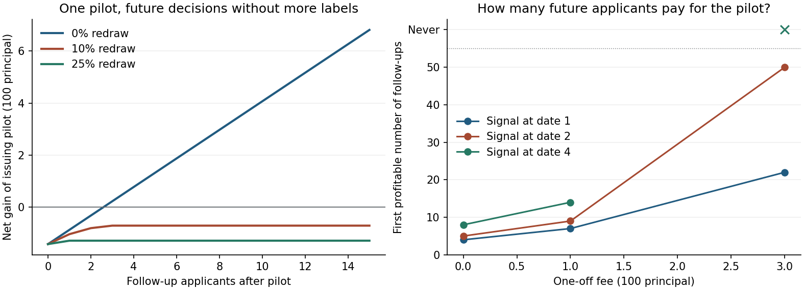

# When can an unprofitable pilot loan pay for itself?

Take the two credit regimes from the [sequential lending example](exploration.md). The first loan loses 1.4125 in expectation on principal 100. Suppose the lender can observe just this one repayment. If the regime persists, the observation is worth 0.548125 per subsequent applicant. The pilot pays for itself with **three later applicants**, or four opportunities including the pilot. If there is a 10% chance of an independent regime redraw between borrowers, even infinitely many later applicants are insufficient. Further experiments change the answer. An adaptive lender that may inspect every funded repayment already issues the first loan with three total opportunities in both examples.

## The decision criterion

Let $F$ be funding the pilot and $W$ declining it now. They generate immediate expected payoffs $u_F,u_W$. Let $k$ be the additional cost of obtaining the pilot information, booked at decision time and excluded from those payoffs. Future rewards are measured in a common numeraire and discounted by $\beta$ per period. Both actions leave the same underlying law for future applicants, public information, and later choices. At later dates both arms receive the same ordinary updates. Only the pilot arm receives its private repayment signal. Suppose funding reveals signal $Z$ before the next decision; waiting yields no signal. Let $V$ be the best future value under the protocol in force, including later experiments if both arms allow them. Then

$$
Q_F-Q_W=u_F-u_W-k+\beta\left(E_Z V(\pi_Z)-V(\bar\pi)\right).
$$

Here $\pi_Z$ is the predictive belief at the next decision after the signal, and $\bar\pi$ is the predictive belief without that observation. The necessary and sufficient condition for strict preference for $F$ is that this **discounted expected value of sample information (EVSI)** exceeds $u_W-u_F+k$. At equality either action is optimal in the pair. If additional first actions exist, their values must also be compared. The identity applies to a risk-neutral monetary objective, or to a specified additively separable utility expressed on one scale.

For arbitrary finite states, signals and actions, with prior $p_s$, signal likelihood $L_{zs}$ and continuation payoff $U_{as}$, the terminal EVSI is

$$
\sum_z\max_a\sum_s p_s L_{zs}U_{as}-\max_a\sum_s p_s U_{as}.
$$

The lender can ignore the signal, so gross EVSI is nonnegative. It is zero exactly when some prior-optimal action remains optimal for every positive-probability signal. This follows by comparing the best branch payoff with the payoff of that single fixed action branch by branch. The rows of $U$ may also be contingent continuation policies with well-defined state-dependent values. A signal can change every posterior probability yet have no value for the decision. The finite-table function in the [implementation](../src/paper11/information_value.py) computes this quantity directly from joint probabilities. [Howard, *Information Value Theory* (1966)](https://doi.org/10.1109/TSSC.1966.300074)

If waiting also generates information, subtract its expected continuation value under its own signal. Nonnegativity of the incremental information effect then requires an information ordering, for example that the waiting signal can be obtained by garbling the funding signal. A pilot that changes future applicant composition, lending capacity or available actions also changes future payoffs through those channels. To compare delayed signals, use the same decision dates for both arms and discount once from each affected date. The one-pilot calculation below makes that timing explicit. [Wei, *Decision-Making Under Selective Labels* (2021)](https://proceedings.mlr.press/v139/wei21a.html)

### When both lenders will receive a new public report

Let $W$ be the public update both arms see by the follow-up decision, and $Y$ the private pilot signal. Their joint likelihood can include dependence. At the pilot decision date, the gross incremental value at the follow-up date is

$$
E_W\!\left[E_{Y\mid W}\max_a E\{U(a,S)\mid W,Y\}
                 -\max_a E\{U(a,S)\mid W\}\right]
=\mathrm{EVSI}(W,Y)-\mathrm{EVSI}(W).
$$

Both terms use exactly the same public data and feasible actions. Discount the difference back to the pilot date before comparing it with the initial loss. The [SBA replay](pilot-replay.md) uses this logic for its comparator: when the pilot outcome matures, both arms may act on the refreshed regional history. Crediting the pilot with the difference against a stale regional estimate would also credit it for information available to the control.

If the public report already reproduces the private signal, its incremental value is zero. Public information can also **increase** the value of a pilot. For a transparent counterexample, assign equal probabilities to the two states $S=0,1$ and pay 1 for guessing the state correctly. Draw a public fair bit $W$ independently of $S$ and report $Y=W\mathbin{\mathrm{XOR}} S$. Each bit seen alone leaves a 50% chance of a correct decision. Together they recover the state exactly, so the incremental value of $Y$ after $W$ is 0.5. The [tests](../tests/test_information_value.py) check both the duplicate and complementary cases using their actual joint likelihoods.

## One observation and an exact cutoff

An applicant's latent probability of default is $Z\in[0,1]$ with any prior distribution. Write $p=E[Z]$ and $v=\operatorname{Var}(Z)$. A repaid loan earns $r$ and a defaulted loan earns $r-c$, with $c\geq0$. The prior expected margin is $\mu=r-cp$. Repayments of different applicants are conditionally independent given their regimes. The regime persists each period with probability $s=1-\lambda$ and otherwise redraws independently from the original prior. It starts at stationarity. All loans have equal principal.

The pilot is issued at date 0. Its realized repayment is known just before date $d\geq1$. There are $m$ later applicants at dates $1,\ldots,m$, so only dates $d,\ldots,m$ can use the signal. Each origination-date margin, including the pilot's margin, is already the present value of that loan's own cash flows; $\beta^j$ brings a future loan's margin back to date 0. The calculation varies signal availability holding those origination-date cash-flow values fixed. Follow-up repayments generate no further usable labels in this protocol. An action plan chosen when the pilot matures may select which future dates receive loans. The lender can finance each selected loan independently, with additive margins, enough capital and no interference among applicants. A binding portfolio budget or changes in other borrowers’ risk caused by a decision would couple the actions and invalidate the sum of individually optimized values.

For a binary pilot outcome, the posterior mean PD is $E[Z^2]/p=p+v/p$ after default and $(p-E[Z^2])/(1-p)=p-v/(1-p)$ after repayment. At future date $j$ the departure from $p$ is multiplied by $s^j$. Define

$$
C=cv,\qquad K=(1-p)(-\mu)_+ + p(\mu)_+,\qquad x_+=\max(x,0).
$$

If $\mu\leq0$, a repayment is the only pilot outcome that can make funding strictly attractive. Its probability times the possible positive margin equals $[C s^j-(1-p)|\mu|]_+$. If $\mu\geq0$, only a default can make declining strictly preferable and the improvement is $[C s^j-p\mu]_+$. Thus in either case the gross EVSI at date $j$ is exactly **$g_j=[C s^j-K]_+$**. Degenerate default probabilities have $v=0$ and provide no information. Only the first two moments of the latent PD distribution enter this single-observation formula. Further observations can depend on higher moments. The [pairwise-dependence analysis](pilot-dependence.md) permits different loans and different dependence assumptions.

For a one-off acquisition fee $k$, the pilot beats declining today if and only if

$$
\boxed{\quad\sum_{j=d}^{m}\beta^j[C s^j-K]_+> k-\mu.\quad}
$$

* **Persistent regime, no discount.** Write $g=[C-K]_+$. For an initially unprofitable pilot and $g>0$, the smallest number of subsequent applicants is $m^*=d-1+\lfloor(k-\mu)/g\rfloor+1$. The floor and additional one enforce strict improvement. If the immediate net margin is already positive, $m^*=0$.
* **Discounted persistent regime.** For $0<\beta<1$, EVSI is $g\beta^d(1-\beta^{m-d+1})/(1-\beta)$ when $m\geq d$. If the infinite sum is at most the initial loss including cost, there is no profitable horizon.
* **Decay and timing.** When $0<s<1$ and $K>0$, only dates satisfying $C s^j>K$ can change a decision. This creates a finite expiration date even when applicants continue to arrive. The finite and infinite sums use two geometric series over those active dates. At $K=0$ information can remain valuable indefinitely while its contribution shrinks. Complete redraw makes every later $g_j$ zero.
* **One fixed cutoff for the whole batch.** If a lending contract forces the same approve-or-decline action at every post-signal date, the gross value is $[\sum_{j=d}^m\beta^j(C s^j-K)]_+$. Placing the positive part outside the sum can reduce the benefit when favorable evidence wears off. The two decision classes coincide in the persistent regime.

## What changes the decision in the worked example?

Here $p=0.2075$, $C=0.0166753125$, $K=0.0111940625$, and $\mu=-0.014125$. With no costs, discount or redraw, $g=0.00548125$ and $m^*=3$. The first loan plus three future opportunities yields a net gain of 0.00231875 per unit principal issued as pilot. At $\beta=0.90$, first usable signal at dates 1, 2 or 4 requires 4, 5 or 8 future applicants respectively. With a fee of 0.03 and disclosure at date 4 even an unlimited calendar cannot justify the loan at that discount.

At 10% redraw probability the only positive increments are 0.00381371875, 0.002312940625 and 0.0009622403125. Their entire undiscounted sum is 0.0070888996875, less than the pilot's expected loss. At 25% redraw probability only the next applicant can benefit, with a value of 0.001312421875.

| Total opportunities, pilot included | Redraw probability | Best policy with at most this one label | Fully adaptive policy | Current-regime oracle |
|---:|---:|---:|---:|---:|
| 2 | 0% | 0 | 0 | 0.079750 |
| 3 | 0% | 0 | 0.007903 | 0.119625 |
| 4 | 0% | 0.002319 | 0.030427 | 0.159500 |
| 10 | 0% | 0.035206 | 0.193698 | 0.398750 |
| 10 | 25% | 0 | 0.055202 | 0.398750 |

All entries are total expected margins at unit loan principal, immediate next-date feedback, zero fee and no discount. The restricted lender can decline the pilot. For example, the zero at horizon 3 records the optimal refusal when there can be no further label. The fully adaptive lender can decide whether to collect a second label after seeing the first.



## Stress design and independent checks

The Cartesian grid uses the following fixed values, weighting each parameter combination equally.

| Input | Values |
|---|---|
| PD in lower-risk / higher-risk regime | 2%, 5%, 10% / 20%, 40%, 60% |
| Prior probability of lower-risk regime | 10%, 25%, 40%, 55%, 70%, 85%, 95% |
| Interest / LGD | 5%, 10%, 20% / 25%, 50%, 75%, 100% |
| Regime redraw per date / discount factor | 0, 0.10, 0.25, 0.50, 1 / 1, 0.97, 0.90 |
| First usable signal date / one-off fee | 1, 2, 4 / 0, 0.01, 0.03 |
| Follow-up applicants | 0, 1, 2, 3, 5, 10, 20, 50 |

Each loan has $r$ equal to the interest rate and $c=(1+r)LGD$. The 756 sets of economics, 45 persistence/discount/delay choices, 3 fees and 8 horizons give **816,480** combinations. In **437,400** the first loan itself has negative expected margin. In **9,017** of those the information justifies issuing it. These counts describe the chosen grid, with repeated economic settings across its horizons. They do not estimate how often exploratory lending pays in any actual applicant population. The numerical decision tables treat gains within $10^{-12}$ units of principal of zero as ties. Under persistent regimes, no discount or fee and immediate next-date feedback, 23 of 405 initially loss-making economics justify the pilot with one future applicant, 36 with three and 47 with ten.

For every combination a second computation updates the two latent-state probabilities separately under repayment/default and directly optimizes each follow-up action. The maximum difference from the moment formula was $4.0\times10^{-15}$ units of principal. An independent finite-horizon Bellman solver checked 81 matching prior/default/reset specifications at 6 horizons (486 comparisons). When there is only one future applicant both decision classes are identical; the maximum value difference was $4.2\times10^{-17}$. At longer horizons a fully adaptive policy weakly dominated its one-label restriction to numerical precision. The tests also compare to explicit transition-matrix powers under a four-state prior, construct distinct distributions with the same mean and variance, and check exact ties, delay, informative signals that leave the action unchanged, and an infinite-horizon fee barrier.

These calculations quantify information under stated conditional repayment laws. The available archive neither identifies the regime prior nor measures persistence, timing or cash-flow transport. Only the simulation grid and the earlier illustrative dynamic model are inputs.

## Reproduce

```sh
PYTHONPATH=src .venv/bin/python -m paper11.information_value --out results
PYTHONPATH=src .venv/bin/pytest -q tests/test_information_value.py
```

[Canonical frontiers](../results/information_value_frontier.csv) use an empty first horizon and `ever_pays=False` when the pilot always fails the strict criterion. An infinite `evsi_limit` is possible with no discount and persistent, decision-relevant information. [Aggregate stress counts](../results/information_value_stress.csv) keep all 1,080 design cells. [Bellman comparisons](../results/information_value_bellman.csv) use the same total horizon in both arms. The [tests](../tests/test_information_value.py) include independent posterior and transition enumerations.
