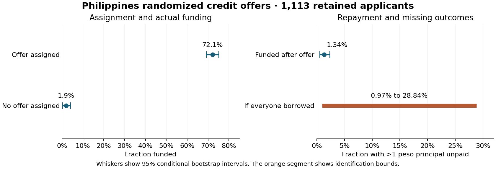

# What can a real randomized credit offer identify?

In 2006–2007, First Macro Bank in the Philippines randomized loan offers to marginal applicants in two credit-score windows. A borrower could decline an offer and the bank retained discretion. This supplies a test that ordinary funded-loan archives cannot perform. We can estimate what the bank collects under an offer policy, including applicants who take no loan. Repayment risk if *everyone* borrowed requires additional assumptions. [Original experiment](https://doi.org/10.1126/science.1200138) · [Sampling and offer probabilities](https://doi.org/10.7910/DVN/VOTBOK)

## Population and checks against the authors

The original randomized population comprised 1,601 applicants, of whom 1,272 were assigned an offer and 329 were assigned rejection. The open analysis file used here retains 1,113 applicants with endline outcomes and covariates, including 891 assigned an offer and 222 assigned rejection. These counts and the mean funded loan size of 674.12 purchasing-power-parity dollars match the external authors' Table 1. The extract covers 69.5% of the original randomized frame. Causal interpretation within the retained sample requires that selection preserves exchangeability within each score window. The extract alone cannot establish this or recover outcomes for the other 488 people. All reported effects refer to the retained mix of marginal loan applicants. [Athey, Fava, Karlan, Osman and Zinman, Table 1 and §2](https://www.nber.org/papers/w35521)

| Score window | Assignment | Applicants | Loans funded | Principal shortfall >1 PHP | Negative cash margin |
| --- | --- | ---: | ---: | ---: | ---: |
| Lower | Offer | 88 | 50 | 2 | 1 |
| Lower | No offer | 73 | 1 | 0 | 0 |
| Higher | Offer | 803 | 600 | 6 | 3 |
| Higher | No offer | 149 | 3 | 0 | 0 |

**Assignment and estimator.** An offer was randomized with probability .60 in the lower and .85 in the higher score window. The released `prop_score` exactly equals the realized arm shares within this extract, .54658 and .84349. We use the released window indicator. For each outcome we estimate the mean separately in each of the four assignment cells. We standardize each assigned arm to the common retained window mix of 161/1,113 in the lower and 952/1,113 in the higher window. The difference of standardized means is the offer intention-to-treat (ITT) estimate. A person who receives an offer and declines it stays in the assigned-offer arm. Four control-arm borrowers received loans and stay in the control comparison. [Processed file and variable definitions](https://bfava.com/ensembleHTE/reference/microcredit.html)

**Units and endpoints.** Funded means `loan_size > 0`. The external authors label the range 312–1,562 and the mean 674 as USD PPP. The CSV mixes units. Across all rows, total payment in nominal Philippine pesos divided by 16 minus loan size in USD PPP reproduces `net_revenue` to floating-point precision. For funded loans, total payment comprises principal, interest and penalties. Unfunded applicants have zero disbursement and zero bank cash flow. Their repayment outcome if they borrowed remains unknown. Cash margin here omits operating costs, funding costs and discounting. The working paper’s separately constructed profit includes estimated costs. [Working paper, §2](https://www.nber.org/papers/w35521)

We define the main adverse repayment event as more than one nominal peso of principal remaining unpaid at the end of the recorded payments. Eight of the 654 funded accounts satisfy it. Another 29 have an unpaid balance of exactly one peso. Counting any positive balance raises the offer-arm standardized funded rate from 1.34% to 5.48%. Moreover, the released `default_value` equals the negative part of cash margin on every row. Only four funded cases have a positive `default_value`, because interest and penalty receipts may offset a principal loss. Neither balance definition establishes ninety-day delinquency or the Spanish paper’s default endpoint.

## What the experiment measures

| Estimand in the retained population | Estimate | 95% conditional interval |
| --- | ---: | ---: |
| Funding when assigned an offer | 72.13% | 69.21% to 75.08% |
| Funding when assigned no offer | 1.92% | 0.20% to 4.05% |
| Change in funding from offering | +70.21 percentage points | +66.50 to +73.53 |
| Change in cash margin per applicant from offering | +46.76 USD PPP | +42.97 to +50.42 |
| Cash margin per unit disbursed under the offer policy | 9.86% | 9.34% to 10.43% |
| Principal shortfall >1 PHP among those funded under the offer policy | 1.34% | 0.51% to 2.37% |

Dividing the cash-margin ITT by the funding ITT gives 66.61 USD PPP [62.19, 71.00] per induced disbursement. Its interpretation as an average among compliers requires random assignment within strata, preservation of that assignment after retention, monotonic take-up, and exclusion of a direct offer effect on bank cash flows for people with unchanged take-up. We retain the arm-level ITT as the primary contrast. Cash margin per unit disbursed divides the arm-level total net cash by its total disbursed principal.

**Policy comparison.** Consider offering only in the higher window, leaving the lower window under the observed no-offer protocol, versus offering in both windows. The latter gives an estimated additional 8.02 percentage points of funding [6.44, 9.53] and 4.19 USD PPP of extra cash margin per retained applicant [3.02, 5.45]. This comparison uses observed offer/control responses in the lower window. Differences in borrower characteristics between windows do not enter as treatment effects. A comparison of all capital or realized margins across countries would require consistent costs, contract terms and accounting.

**Audit of a transported prior.** Use the observed upper-window shortfall proportion among those funded after an offer as a constant prior for funded lower-window loans. The upper window supplies 6/600, or 1.00% [exact 95% interval 0.37%, 2.16%]. Applied to the 50 lower-window loans, the prior predicts 0.50 shortfalls. We observe 2/50, or 4.00% [0.49%, 13.71%]. A two-sided Fisher test comparing the two funded samples gives p = .121. The lower-window outcomes do not enter the prior, although this diagnostic was proposed after reviewing the counts. These few events leave substantial uncertainty about transport. Conditioning on funding also selects different potential borrowers in the two windows. The exercise checks a simple prior against observed repayments within that group.

**What stays unknown.** Write F for taking a loan and D for the binary shortfall that would occur on a loan at the offered terms. In the offer arm, repayment labels are available for F=1. Let p be the standardized mean of F and q the standardized mean of FD. With only binary outcome support and consistency for those who borrow, the identified interval for the hypothetical all-funded event rate runs from q to q+1−p. The two extreme assignments give risk **0.97% to 28.84%**. Those endpoints are identification limits. Sampling uncertainty surrounds each limit separately. The finite-sample point estimates and conditional uncertainty for both endpoints are in the contrast table.

**Uncertainty.** The 95% percentile intervals use 1,999 resamples of complete applicants within the four score-window-by-assigned-arm cells, keeping their sizes and the window weights fixed. They are conditional, approximate intervals and exclude uncertainty about attrition, contract changes and extrapolation to other applicants. Eight principal shortfalls provide little information about tail risks. The single-window event intervals in the prior comparison use exact Clopper–Pearson limits. The Fisher test compares observed event proportions across funded groups and has no causal interpretation for changing a borrower's baseline score.

## Reproducibility

Run `PYTHONPATH=src .venv/bin/python -m paper11.rct --cache data/cache --out results`. The module downloads the authors’ processed file from a pinned revision of their public package. The package repository carries Apache-2.0 and the original study archive lists CC0. This project distributes code and aggregate results. The borrower data are fetched on demand into the ignored cache. [Pinned processed CSV](https://github.com/bfava/ensembleHTE/blob/1a64d156edf7aa8c97bc9e928b4cda6e706cc9de/data-raw/microcredit.csv) · [Package license](https://github.com/bfava/ensembleHTE/blob/1a64d156edf7aa8c97bc9e928b4cda6e706cc9de/LICENSE) · [Original archive](https://doi.org/10.7910/DVN/VOTBOK)

The input SHA-256 is `7ca62db2649bf59450cd58cc8be274201eca26096a51b4259b88f54209229054`. The entry point checks published assignment counts and reconciles loan and repayment amounts before writing results. Outputs comprise the [four-cell ledger](../results/rct_cells.csv), [effect estimates](../results/rct_contrasts.csv), [prior transport check](../results/rct_prior_transfer.csv) and the figure above. This separate study uses actual randomized offers to investigate selective labels and policy value. It supplies independent external evidence for those estimands and does not identify Monedo’s undisclosed scorecards, repayment labels or profitability.
