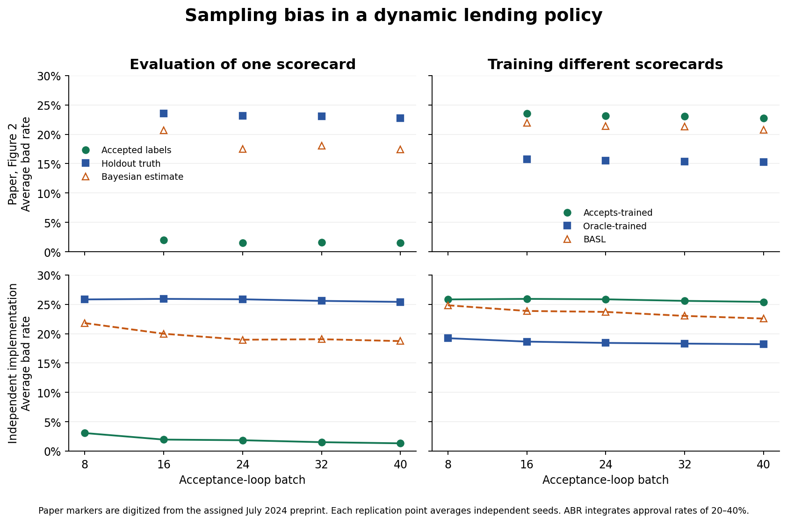

# Synthetic lending experiment

This independent implementation follows the feedback experiment in Appendix C. It asks two different questions. Can a lender measure a fixed scorecard on future applicants when repayment labels come mainly from accepted loans? Can adding selected pseudo-labeled rejects improve the scorecard itself? The first question keeps the scorecard fixed and varies the evaluator. The second keeps the labeled population holdout fixed and varies the scorecard. Source values come from §7.1.1, Figure 2 and Tables C.3–C.4 of the July 2024 version assigned for this course. [Assigned preprint](https://arxiv.org/abs/2407.13009v1)

## Design

Each trial draws a population with a 70% default rate. For goods, the two 2D Gaussian means are (0,0) and (1,1). For bads they are (2,1) and (3,2). Both classes have two independent standard-normal nuisance features. The simulation uses equal component weights because Appendix E.1 does not give their values. For each covariance matrix, it samples the three unique entries from U(0,1) until the symmetric matrix is positive definite, with determinant above 0.00001. The four accepted covariances stay fixed within a trial. A new trial draws a new population. The authors do not specify how they enforce positive definiteness or whether the same covariance realization is reused across their trials.

Each batch has 100 applicants. The initial bureau policy approves the 15 lowest values of the first feature. This defines the credit-quality score as −x₁ because the bad component means are higher. In subsequent batches the bank approves 15 people with the lowest predicted default probabilities, randomly breaking ties. It refits the accepts-only XGBoost scorecard on cumulative historical accepts after every batch. If all observed repayments so far have the same outcome, a Laplace-smoothed constant score supplies the next round of scores. Only past exposed outcomes enter the next decision. The full-label comparator has the same classifier settings with repayment outcomes for the entire training pool.

The canonical run uses 20 independent seeds (15011–15030) and 40 batches. At batches 8, 16, 24, 32 and 40, independently generated cohorts supply calibration labels, BASL stopping data and experimental evaluation data. Each evaluation cohort undergoes the same historical policies as the training pool. These extra cohorts are a design choice that keeps calibration, model selection and the evaluation experiment separated. A representative labeled holdout of 3,000 applicants per seed is reused to measure true performance. The article reports 100 trials and up to 500 iterations, so its full-run averages include much later stages. The digitized figure below compares shared early stages.

The estimated prior fits logistic calibration to the baseline model's log odds and observed accepts in the calibration cohort. The experiment uses 100 Monte Carlo draws, the lower bound of the preprint's 100–10,000. BASL stopping uses the exact conditional expectation of integrated ABR. With default probabilities held fixed, ABR is linear in the unknown labels. Using its exact expectation removes noise in early stopping. See the [method implementation notes](algorithm.md).

## Benchmarks

RMSE uses prediction error against the holdout metric of the same fixed accepts-only scorecard in the same trial and batch. ABR averages default rates over approval fractions from 20% to 40%. AUC and PAUC measure ranking. Brier measures probability accuracy. PAUC uses the FNR range [0,.2] and the standardized AUC convention documented in the methods notes.

| Metric | Accepted-only RMSE, authors | Bayesian RMSE, authors | Accepted-only RMSE, ours | Bayesian RMSE, ours |
| --- | ---: | ---: | ---: | ---: |
| AUC | .2205 | .1000 | .0768 | .0584 |
| Brier | .0828 | .0566 | .0552 | .0670 |
| PAUC | .2803 | .1187 | .1136 | .0725 |
| ABR | .2010 | .0929 | .2433 | .0771 |

For ABR, the accepted-only estimate averaged 1.96% against 25.71% on the full holdout. The calibrated Bayesian estimate averaged 19.71%. Its RMSE fell by 68.3% relative to accepted-only evaluation. Brier was the exception. Its RMSE rose from .0552 to .0670, showing that improvement in a ranking or approval metric can coexist with worse probability accuracy. Our shorter horizon, per-trial mixture variation, calibration and disjoint cohorts can affect the levels. No experiment here isolates how much of the numerical difference is due to each.

In the training experiment, the accepts-only scorecard incurred 7.15 percentage points more ABR than the full-label oracle. BASL reduced this by 2.12 points, with a 95% trial-bootstrap interval of 1.33–2.98 points. The recovered fraction was 29.61% [21.22%, 37.28%], versus 24.82% in Table C.4. This ratio divides the mean improvement by the mean oracle gap. A change of two points in default rate refers to the accepted borrowers at comparable approval fractions.

**Sensitivity to stopping.** In Appendix B.3 the candidate set starts empty and stores a model after at least one pseudo-labeling round. The main run follows this rule when augmentation is possible. A conservative variant also allows the original accepts-only scorecard to win. The prior used for early stopping comes from a calibrated version of that same baseline. Permitting it to win selected round zero at 99 of 100 checkpoints and reduced recovery to 0.08%. This sensitivity concerns model selection and feedback from the prior. It does not change the results of evaluating a fixed model in the preceding table.

**Controls.** The known conditional-default probabilities of the synthetic Gaussian mixture give ABR RMSE .0168. Revealing a random 15% of repayment labels gives .0564. Permuting estimated prior probabilities among rejects gives .1516, compared with .0771 for the calibrated prior in its original order. Permutation preserves the rejected pool's mean prior and destroys its relationship to applicant risk. Even evaluating every validation applicant against their real outcomes gives finite-sample RMSE .0167 against the independent holdout.



## Figure provenance

The upper panels reproduce four shared points for each curve in the submitted Figure 2(d/e) on page 12. The points are digitized from the vector artwork and rounded to five decimals. The figure’s paths begin around batch 10, so only 16, 24, 32 and 40 appear in the upper panels. The two plotted versions of the identical baseline on the holdout differ slightly in the source vector rounding. The lower panels show the means from our independent trial results at all five checkpoints.

The assigned PDF has SHA-256 `482c5423a9846fe31e6168f04e6ec918b77eeb0b3f45302637e3b8b93705c2c4`. The following command exports page 12 with Poppler.

```sh
pdftocairo -f 12 -l 12 -svg assigned-paper.pdf fig2.svg
```

Read the six color-line paths with stroke width 3.2 before their affine display transform. The x coordinates span 53.129083–477.724249 for 0–500 batches on (d) and 561.997967–981.935565 on (e). The y coordinates 31.829398–289.253433 correspond to ABR 0–.25 on (d) and 56.247448–290.246926 correspond to .15–.25 on (e). Apply linear interpolation between axis ticks to convert each path vertex to data coordinates. Green, blue and orange correspond to the legend order in each panel. The values embedded in `FIG2_POINTS` regenerate the machine-readable digitization independently of the distributed results directory. Separately, §7.1.1 prints the long-run evaluation anchors .0140 and .2095. Their averages can be checked against the full source paths.

## Reproduction and uncertainty

Run these commands from the project root after installing the pinned dependencies.

```sh
PYTHONPATH=src .venv/bin/python -m paper11.simulation --out results
PYTHONPATH=src .venv/bin/python -m pytest -q tests/test_simulation.py
```

The simulator writes four files to any new output directory. `simulation_trajectory.csv` contains seed-level data for every checkpoint. `simulation_comparison.csv` contains paper references, estimates, intervals and the number of independent trials for each statistic. Empty paper values denote unreported reference numbers. `simulation_fig2_digitized.csv` holds the 24 source readings and `simulation_fig2.png` draws the comparison. The 95% percentile intervals resample trial seeds 2,000 times while keeping an entire trajectory together. Thus five observations from one policy history contribute one independent sampling unit. These intervals describe simulation uncertainty for this finite design. They are pointwise across metrics. MMD, the paper's 500-batch long horizon and the private Spanish randomized experiment are outside this synthetic comparison.

For the completed reproducibility check, a fresh scratch directory held only the package initializer, methods and simulation source. Repeating the full 20-trial run there with two workers and the pinned project environment produced byte-identical outputs to the canonical three-worker run across all three CSVs and the PNG. A separate automated CLI test repeats a small experiment in an empty directory and checks the output names, a digitized point, and the PNG header. Other tests cover the analytical conditional PD, selection invariance to hidden labels, random-label disclosure as a negative control, deterministic feedback and the RMSE and oracle-gap calculations.
