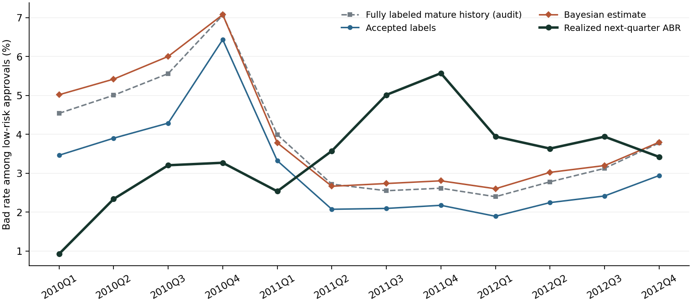
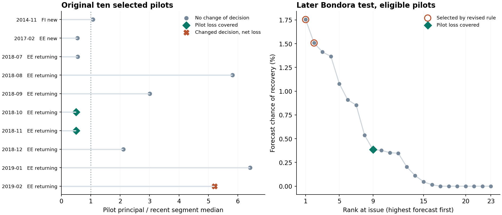
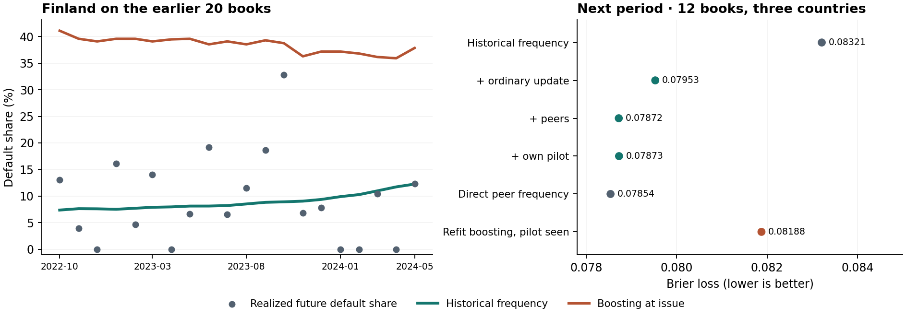
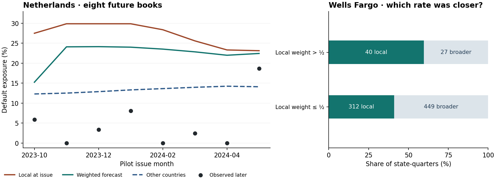

# Team 12 · Fighting Sampling Bias

Team 12 · Andrey Tsember, Sofia Shapovalova, Ksenia Stepanova, Marat Bineman and Alexia Fox.

This report uses the assigned preprint and public borrower records. An approval scorecard is needed for everyone who applies, while repayment is usually observed only for the people actually financed. Training with inferred labels and evaluating on the complete applicant mix solve different problems.

## Summary

- **Simulation.** Bayesian evaluation cuts the error in estimating ABR from 24.33 to 7.71 pp (paper: 20.10 to 9.29). BASL recovers 29.6% of the gap to full-label training (95% interval 21.2% to 37.3%; paper 24.8%).

- **Public cohorts.** Bayesian evaluation lowers the ABR estimation error on Taiwan (1.43 → 1.35 pp) and Prosper (1.35 → 0.35 pp), but the paired changes, −0.08 pp [−0.95, +0.78] and −1.00 pp [−1.33, +0.53], include zero. BASL changes ABR by +0.16 pp [+0.02, +0.30] on Taiwan and +0.01 pp [−0.22, +0.26] on Prosper. At 50% LGD every evaluator picks the same cutoff, so the paper's profit gain does not appear here. On the same Taiwan cohort, with no change of population, Bayesian evaluation is worse (1.79 versus 0.59 pp) because its logistic prior is weak there; on Prosper it improves (1.13 → 0.13 pp).

- **When reject inference works (prespecified).** As historical selection sharpens at a fixed acceptance share, accepted labels misstate a Taiwan scorecard's bad rate by 1.37 to 3.27 pp. Bayesian evaluation helps once selection is moderate (−1.40 pp [−1.69, −0.92] at s = 4) but not when it is very weak. Both corrections rest on a model of the rejects: the accepts-trained logistic model ranks them with AUC 0.77 at s = 1 and 0.41 under a hard cutoff, where BASL raises the default rate by +2.97 pp (folds +0.94 to +7.83). A random 5% audit of training rejects lifts that AUC to 0.71 and cuts BASL's damage to +0.31 pp; training on the audited outcomes alone changes the approved default rate by −1.45 pp [−1.74, −1.15]. Three of seven hypotheses were not supported, as the study reports.

- **Which outcomes decide a policy.** Totals for the four bands between five cutoffs identify 50 of 50 pairwise differences; totals for ten prior-risk deciles identify 0.

- **Lending to learn.** In the illustrative model a pilot of principal 100 loses 1.41; with persistent risk its outcome pays back after 3 later loans, and with a 10% chance of a reset per loan the total value is capped at 0.71. In later Bondora loans the frozen selector missed the only recovery.

- **Early defaults.** On eight Dutch dates the six-month forecast averaged 7.17% against 4.79% realized and histories of 27.19% and 13.36%. At a Czech bank the fixed rule changed 16 of 143 book decisions, but the other-region rate kept the lowest Brier loss (0.0811 versus 0.0852). Of the 6 correct Dutch warnings, 3 disappear if the young cohorts' own year-one rate replaces the six-month conversion, so the conversion's undershoot did part of the work.

Outcomes on Taiwan and Prosper come from funded loans with simulated selection; the Monedo randomized holdout is private. Extension samples are small, and the sections below give each design and its uncertainty.

## Synthetic replication of Figure 2

| Statistic | Paper | Estimate | 95% low | 95% high |
|---|---|---|---|---|
| Accepted-only evaluation error (RMSE) | 0.2010 | 0.2433 | 0.2218 | 0.2648 |
| Bayesian evaluation error (RMSE) | 0.0929 | 0.0771 | 0.0618 | 0.0932 |
| ABR gap, accepted-only vs full-label training | 0.0598 | 0.0715 | 0.0595 | 0.0846 |
| Share of that gap BASL recovers | 0.2482 | 0.2961 | 0.2122 | 0.3728 |

Twenty independent runs, 40 batches each. Intervals resample complete simulation seeds. Recovery is a fraction of the gap between accepted-only and full-label training. Evaluation error is measured against true holdout labels. The first four shared plotted checkpoints are displayed on identical axes. The published long-run summaries cover a longer experiment.

## Published Monedo versus our public-cohort experiments

Table 2 compares errors in prediction of a scorecard metric; smaller is better. Table 3 compares scorecards on held-out borrowers. Smaller Brier and ABR, higher AUC and pAUC are better. The reweighting rows compare different weight estimators. Targets, default rates and approval mechanisms differ across datasets.

| Paper table | Method | Monedo (paper) | Taiwan | Prosper |
|---|---|---|---|---|
| 2 | Accepted-only | 0.0356 | 0.0143 | 0.0135 |
| 2 | Bayesian | 0.0130 | 0.0135 | 0.0035 |
| 2 | Reweighting | 0.0315 | 0.0105 | 0.0068 |
| 3 | Accepted-only | 0.2388 | 0.0720 | 0.0340 |
| 3 | BASL | 0.2211 | 0.0737 | 0.0341 |
| 3 | Hard cutoff | 0.2458 | 0.0739 | 0.0402 |
| 3 | Reweighting | 0.2346 | 0.0723 | 0.0329 |

The complete four-metric comparison is in [paper_comparison.csv](paper_comparison.csv).

## Training, risk lift and calibration

| Data | Method | AUC | Brier | pAUC | ABR | Top-decile lift |
|---|---|---|---|---|---|---|
| Prosper | Accepted-only | 0.6313 | 0.0596 | 0.5660 | 0.0340 | 1.9784 |
| Prosper | BASL | 0.6350 | 0.0596 | 0.5633 | 0.0341 | 2.0036 |
| Prosper | BASL, baseline eligible | 0.6350 | 0.0596 | 0.5633 | 0.0341 | 2.0036 |
| Prosper | Hard cutoff | 0.5984 | 0.0605 | 0.5487 | 0.0402 | 1.6547 |
| Prosper | Reweighting | 0.6291 | 0.0598 | 0.5667 | 0.0329 | 1.8885 |
| Prosper | Logit | 0.6116 | 0.0599 | 0.5563 | 0.0367 | 1.7266 |
| Taiwan | Accepted-only | 0.7766 | 0.1357 | 0.6338 | 0.0720 | 3.1332 |
| Taiwan | BASL | 0.7768 | 0.1360 | 0.6317 | 0.0737 | 3.1349 |
| Taiwan | BASL, baseline eligible | 0.7766 | 0.1360 | 0.6324 | 0.0731 | 3.1364 |
| Taiwan | Hard cutoff | 0.7748 | 0.1433 | 0.6302 | 0.0739 | 3.1558 |
| Taiwan | Reweighting | 0.7768 | 0.1361 | 0.6334 | 0.0723 | 3.1273 |
| Taiwan | Logit | 0.7218 | 0.1485 | 0.5659 | 0.1212 | 3.0487 |

Lift10 is the bad rate in the riskiest tenth divided by the population bad rate. The Taiwan test shows a modest increase in bad loans among the safest borrowers under BASL. The Prosper training contrast is small relative to its interval. The simulated training improvement does not transfer consistently.

The diagonal represents perfect calibration. Each point represents an equal-frequency group (ties kept together); the cohorts have separate scales. Calibration measures agreement between predicted and observed frequencies, while AUC measures ordering.

## Exposure to the prior

| Method | Prosper | Taiwan |
|---|---|---|
| Accepted-only | 0.0135 | 0.0143 |
| Bayesian | 0.0035 | 0.0135 |
| Bayesian, reject odds ×2 | 0.0025 | 0.0370 |
| Bayesian, reject odds ×½ | 0.0068 | 0.0082 |
| Reweighting | 0.0068 | 0.0105 |

The central Bayesian prior is a logit trained only on observed training outcomes. Halving or doubling reject odds leaves the scorecard and its rankings unchanged. It changes which hidden outcomes are assumed when estimating performance. A stronger prior in one cohort can be worse in another. Taiwan RMSE uses four folds; the single chronological Prosper split yields an absolute error.

The complete labels in the validation cohort also allow a retrospective test that removes population transfer. On Taiwan the accepted-only and Bayesian errors are 0.0059 and 0.0179, respectively. On Prosper they are 0.0113 and 0.0013. Taiwan's small improvement on an independent same-vintage sample therefore cannot be attributed solely to correcting selection.

## Paired uncertainty

| Data | Contrast | Estimate | 95% low | 95% high |
|---|---|---|---|---|
| Taiwan | BASL − accepted-only: ABR | 0.0016 | 0.0002 | 0.0030 |
| Taiwan | Bayesian − accepted-only: margin at 50% LGD | 0.0000 | 0.0000 | 0.0000 |
| Taiwan | BASL − accepted-only: Brier | 0.0003 | 0.0000 | 0.0006 |
| Taiwan | Bayesian − accepted-only: ABR estimation error | -0.0008 | -0.0095 | 0.0078 |
| Prosper | BASL − accepted-only: ABR | 0.0001 | -0.0022 | 0.0026 |
| Prosper | Bayesian − accepted-only: margin at 50% LGD | 0.0000 | 0.0000 | 0.0000 |
| Prosper | BASL − accepted-only: Brier | 0.0000 | -0.0002 | 0.0002 |
| Prosper | Bayesian − accepted-only: ABR estimation error | -0.0100 | -0.0133 | 0.0053 |

Training comparisons use the same test borrowers under both models. Evaluation-error comparisons assign each borrower one shared Poisson weight wherever it recurs across folds. Intervals are conditional on fitted models and logged decisions. Both empirical intervals for the change in ABR estimation error include zero. Zero conditional policy variance at the base LGD means the methods took the same decisions on these cases.

## Conditional lending policy

| Data | LGD | Accepted-only | Bayesian | Reweighting | Bayesian − accepted-only |
|---|---|---|---|---|---|
| Prosper | 0.2500 | 0.0431 | 0.0431 | 0.0431 | 0.0000 |
| Prosper | 0.5000 | 0.0378 | 0.0378 | 0.0378 | 0.0000 |
| Prosper | 0.7500 | 0.0325 | 0.0325 | 0.0325 | 0.0000 |
| Prosper | 1.0000 | 0.0272 | 0.0272 | 0.0272 | 0.0000 |
| Taiwan | 0.2500 | 0.0372 | 0.0372 | 0.0372 | 0.0000 |
| Taiwan | 0.5000 | 0.0242 | 0.0242 | 0.0242 | 0.0000 |
| Taiwan | 0.7500 | 0.0124 | 0.0118 | 0.0124 | -0.0006 |
| Taiwan | 1.0000 | 0.0067 | 0.0062 | 0.0067 | -0.0006 |

The entries are margin in units of principal per arriving applicant using an assumed 10% return if repaid. Issuance rates, per-issued-unit margins and numerical cutoffs are in [policy.csv](policy.csv). At 50% LGD all three estimators select the upper end of the allowed rate grid, so the realized difference is exactly zero. The paper’s stated gain in profit depends on its pricing, approval decisions and Spanish borrower population.

## Does a hard historical cutoff change the conclusions?

The main design accepts each applicant with probability 0.05 + 0.90 expit(index), so every applicant can be observed. This sensitivity keeps the index, folds, seeds, models and priors, and accepts the applicants with the highest index, keeping tied values together and matching the acceptance share as closely as the ties allow. Historical rejects then never resemble accepts on the index, as under a scorecard cutoff.

| Data | Historical policy | Accepted | Bad rate, accepted / rejected | ABR estimation error, pp (accepted-only → Bayesian) | Test ABR (accepted-only → BASL) |
|---|---|---|---|---|---|
| Taiwan | soft | 63.7% | 17.4% / 30.4% | 1.43 → 1.35 | 7.20% → 7.37% |
| Taiwan | hard | 67.3% | 12.2% / 42.4% | 3.27 → 2.33 | 8.53% → 11.50% |
| Prosper | soft | 56.5% | 8.2% / 16.5% | 1.35 → 0.35 | 3.40% → 3.41% |
| Prosper | hard | 56.4% | 6.5% / 18.6% | 1.43 → 0.50 | 3.62% → 3.77% |

Stronger selection makes accepted-only evaluation worse and Bayesian evaluation helps more; on Taiwan the paired interval now excludes zero. BASL becomes worse on Taiwan in every fold, though by very different amounts; the borrower-bootstrap intervals hold the fitted models fixed and understate that variation. On the hard-cutoff validation rejects the accepts-trained logistic prior averages 9.6% against an actual 43.3% and ranks them with AUC 0.41, so a logistic pseudo-labeler marks many risky rejects as good, while even this understated prior moves the evaluation toward the truth. The check was added after the main results and is exploratory. [Design and interpretation](../docs/hard-selection.md) · [All quantities](hard_selection.csv)

## When does reject inference work?

A prespecified study varies the sharpness of simulated historical selection at a fixed acceptance share and adds a random 5% audit of training rejects to the reject model. Folds, seeds and scorecards follow the main experiment.

| Taiwan | s = 0.5 | s = 1 | s = 2 | s = 4 | hard |
|---|---|---|---|---|---|
| Bad rate, accepted / rejected | 19.2 / 27.2% | 16.8 / 31.3% | 14.4 / 35.6% | 13.1 / 37.8% | 12.2 / 42.4% |
| Evaluation error, accepted labels, pp | 1.37 | 1.58 | 1.57 | 2.48 | 3.27 |
| Evaluation error, Bayesian with logistic prior | 1.77 | 1.45 | 1.05 | 1.09 | 2.33 |
| Evaluation error, Bayesian with audited prior | 1.74 | 1.52 | 1.26 | 0.91 | 1.29 |
| Reject AUC, logistic / audited prior | 0.77 / 0.76 | 0.77 / 0.77 | 0.70 / 0.76 | 0.40 / 0.75 | 0.41 / 0.71 |
| BASL − accepted-only ABR, pp (fold range) | −0.09 (−0.20 to +0.17) | −0.04 (−0.19 to +0.39) | −0.01 (−0.20 to +0.14) | +0.01 (−0.53 to +1.34) | +2.97 (+0.94 to +7.83) |
| Same with the audit | −0.12 | +0.00 | +0.06 | +0.04 | +0.31 |
| Training on audited outcomes, ABR change, pp | −0.16 | −0.15 | −0.07 | −0.71 | −1.45 |

Accepted labels mislead more as selection sharpens, and Bayesian evaluation helps once selection is moderate. The accepts-trained logistic model ranks rejects backwards under sharp selection; that is when BASL damages the scorecard. A small random audit repairs the reject model, and training on its outcomes improves the scorecard where BASL harms it. Prosper moves in the same direction with smaller selection effects. [Protocol](../docs/selection-strength-protocol.md) · [Results and hypotheses](../docs/selection-strength.md) · [All quantities](selection_strength.csv)

## Can a small randomized audit improve ABR measurement?

| Data | Labels audited | Design | Audit RMSE | Prior-only RMSE |
|---|---|---|---|---|
| Prosper | 10 | All past rejects | 0.0289 | 0.0003 |
| Prosper | 10 | Rejects the policy would fund | 0.0088 | 0.0003 |
| Prosper | 50 | All past rejects | 0.0111 | 0.0003 |
| Prosper | 50 | Rejects the policy would fund | 0.0031 | 0.0003 |
| Taiwan | 10 | All past rejects | 0.0455 | 0.0188 |
| Taiwan | 10 | Rejects the policy would fund | 0.0195 | 0.0188 |
| Taiwan | 50 | All past rejects | 0.0201 | 0.0188 |
| Taiwan | 50 | Rejects the policy would fund | 0.0086 | 0.0188 |

For a fixed proposed 30% approval policy, each audit reveals 10 or 50 funded outcomes under controlled masking. Both designs reveal the same number of outcomes. Financial exploration costs may differ. Targeting only previously declined borrowers whom this policy would approve lowers sampling variability. Compare against prior-only RMSE as well: a good prior can beat a noisy small audit on a given cohort. Random disclosure identifies the fixed-policy default rate in this finite validation cohort; small samples may still be imprecise. Each result pools squared error across 500 draws per split before taking the square root.

## Our extensions

### Which measurements recover every policy difference?

Consider five nested policies, with four nonempty groups entering between consecutive cutoffs. Their four unknown expected margins suffice for every exact pairwise comparison. When those margins can vary on an open set, four is the minimum number of independent linear measurements for that task. The sign alone can sometimes be learned with fewer. For general lending rules, the answer is the rank of the matrix of differences on the unknown margins.

| Design | Policy pairs | Differences identified exactly | Decisions settled |
|---|---|---|---|
| Four bands between cutoffs | 50 | 50 | 50 |
| Ten prior-risk deciles | 50 | 0 | 1 |

The rows above use the actual aggregate counts of masked outcomes, disclosed retrospectively on each validation split. Counts are comparisons across four Taiwan splits and one Prosper split. [Data-independent proof and finite-cohort check](../docs/policy-information.md)

### When can a lender pay to observe a repayment?

In the illustrative persistent-regime decision model, a loan of 100 has immediate expected margin -1.41. Starting with 3 applicants available, the lender first finds funding worthwhile: its optimal total expected margin is 0.79, versus zero under the best fixed decision. At ten opportunities the total reaches 19.37. If each new borrower draws an independent regime, a repayment has zero value for the next decision. The horizon counts all applicants, including the pilot. Repayment on a funded loan arrives before the next decision. These are illustrative monetary units, independent of the public datasets. [Decision tree, assumptions and tests](../docs/exploration.md)

### The price of a single repayment observation

Compare the expected loss on the pilot with the discounted increase in the best future policy's value after observing that repayment. Both policies can use the same other information. On 100 units of principal the persistent example loses 1.4125 up front and adds 0.548125 per later decision. It clears break-even at 3 later applicants. With a 10% redraw probability the lifetime gain is bounded by 0.70889. [General criterion and analytic proof](../docs/information-value.md) · [Sharp bounds for different pilot and follow-up risks](../docs/pilot-dependence.md)

The grid spans 816,480 parameter combinations. Of the 437,400 with negative direct expected margin, a single pilot covers that loss in 9,017. Grid frequencies describe our design. [Aggregate stress results](information_value_stress.csv)

### Does this signal change decisions on historical SBA 504 loans?

The administrative extract has 111,066 rows, with 92,410 eligible disbursements. We compare identical regional follow-up portfolios using a common updated risk estimate. Each episode evaluates the first 25 continuation positions. The future quarterly source pools contain 51,444 financed loans. Among 79 initially loss-making region-quarter episodes the plug-in rule selected 3 pilots. At disclosure the signal could change the decision in 0 of these. Including the pilot cash flow, the incremental margin was -0.022 per eligible episode, in units per 100 principal on one loan (95% moving-block interval -0.076 to +0.005).

Requiring a pilot in every eligible episode gave +0.019 in gross continuation gain and -0.364 in direct pilot margin. Net gain versus the updated no-pilot policy was -0.345 [-0.529, -0.194]. The financial terms are scenarios applied to three-year recorded charge-offs. Results concern historically financed loans and the specified decision rule. [Replay protocol, comparators and sensitivity](../docs/pilot-replay.md)

### Could the bank identify promising pilots in advance?

Each rule receives only information available at origination and pays the direct pilot margin once. A new forecast allows the public risk estimate to change while repayment is pending, using only earlier public updates that have already arrived. Both rules face the same future opportunities.

Bondora, at least three years of subsequent payments: the fixed-risk rule selected 2 of 100 eligible pilots. AUC for positive realized scenario gain was 0.609 (95% four-quarter block interval 0.478 to 0.734). Net versus skipping all pilots was +0.200 per eligible episode when one loan has principal 100. Positive net can also come from collecting the pilot itself.

SBA 7(a), using early local pricing: the fixed-risk rule selected 16 of 85 eligible pilots. AUC for positive realized scenario gain was 0.416 (95% four-quarter block interval 0.206 to 0.624). Net versus skipping all pilots was -0.691 per eligible episode when one loan has principal 100. Positive net can also come from collecting the pilot itself.

SBA 7(a) offers an existence example. In the West, one actual failed pilot from 2002 Q2 could have changed the rule from funding to declining the same 25 later loans. Using reported charge-off amounts and the hypothetical performing margin gives -98.00 on the pilot, +209.13 on subsequent decisions and +111.14 overall. We identified this branch after scoring. Its region-quarter was selected up front, but the precommitted borrower draw chose a different pilot. [Exact branches and calendar windows](../docs/pilot-transfer.md)

In the extended Bondora window, the October 2018 Estonian pilot lost €267.00. Relative to lending to all 25 subsequent borrowers in November 2019, the pilot-informed refusal would avoid €16,211.29 in cash shortfall as of May 24, 2024. The paired net is €15,944.29. Across the 3 selected pilots that changed a decision, 2 still covered their actual euro loss at this date. This follow-up uses the same loan identities, and outstanding collections could change the result. These decisions were replayed.

In Kenya the bank used its TOBOA experiment with previously rejected borrowers to revise the M-Shwari scorecard. The case study reports acceptance rising from 40% to 47%. It gives no incremental profit attributable to that change. [Field evidence](../docs/observed-pilot-evidence.md) · [European payment archives](../docs/lender-pilot.md) · [Forecasts, units and uncertainty](../docs/pilot-targeting.md)

### Can the archive identify which policy earns more?

Hold all visible outcomes fixed. Grant access to the actual number of defaults in each of ten groups of hidden applicants ranked by the frozen prior. The grouping is fixed before reading the true aggregate counts. On Taiwan, moving these same defaults within groups yields both negative and positive gains for the same 30% to 50% expansion in every split. The mean bounds are -0.82 to +0.99 pp of scenario margin per applicant. On Prosper these ten true counts are sufficient to determine a positive sign (+0.20 to +1.47 pp). These aggregates use retrospective information unavailable to the original lender. A second sensitivity case substitutes counts obtained by rounding the prior probabilities. We also solve the minimax-regret choice among five cutoffs and audit the frozen rule on holdout. [Construction, proof and results](../docs/identification.md)

### What would it take to resolve the decision?

For the Prosper validation pool, 160 repayments among the additional approvals were hidden. In the retrospective truth, 17 defaulted. The exact random-order audit uses 14.46 labels on average. At the last profitable and first unprofitable hidden default counts it uses 152.89 and 153.02. The prespecified review schedule bounds wrong-direction decisions by 5% for each fixed population. The required sample depends on how close that population is to break-even. [Stopping boundaries, proof, and sample-size distributions](../docs/decision-audit.md)

[What the authors did, what Team 12 added, and how the evidence compares with Paper 15](../docs/contributions.md)

### Correcting old labels versus predicting the next quarter

| Method | Quarters | Historical RMSE, pp | Next-quarter RMSE, pp | Quarters better than accepted-only |
|---|---|---|---|---|
| Accepted-only | 12 | 0.7856 | 2.0751 | 0 |
| Bayesian | 12 | 0.2614 | 2.3566 | 7 |
| Reweighting | 12 | 0.1698 | 2.3915 | 7 |
| Complete history | 12 | 0.0000 | 2.2677 | 7 |

Both RMSE columns above are in percentage points of integrated ABR. Bayesian evaluation improves historical measurement but produces larger next-quarter RMSE over twelve Prosper cohorts, despite winning in seven individual quarters. The historical oracle uses complete previous outcomes and still experiences temporal transfer error. [Period definitions and error decomposition](../docs/vintages.md)

### Prior sensitivity at a lending decision

With 10% interest, 50% LGD and a fixed 30% incumbent, the validation lower bound for the 50% expansion's conditional expected margin stays nonnegative up to an odds multiplier of 1.85–2.30 in Taiwan and 13.19 on Prosper. Absolute cutoffs are frozen before testing. With unrestricted missing outcomes a zero-downside validation rule retains the incumbent. These are sensitivity endpoints, distinct from sampling confidence intervals. [Definitions, paired gains and held-out results](../docs/bounds.md)

### Randomized offers and actual borrowing in the Philippines

The analytic extract contains 1,113 marginal applicants. Expanding offers from the high score window to both windows changes the funding rate by 8.02 percentage points and the lender cash margin by 4.19 PPP dollars per assigned applicant (95% bootstrap interval 3.02 to 5.45), before other costs. The result refers to this selected extract under within-window comparability. The underlying experiment was conducted by Karlan and Zinman.

The estimated share with a principal shortfall greater than one peso under hypothetical universal funding is only bounded between 0.97% and 28.84% if the non-takers’ repayment is unrestricted. This identified set has a different interpretation from a confidence interval. As a sparse check of a risk prior carried over from the high score window, the observed lower window has 2 shortfalls among 50 funded borrowers versus 0.50 expected. [Assumptions, primary sources and exact rare-event comparison](../docs/rct.md)

### Did a cheaper pilot and an exposure-aware forecast transfer?

Both Estonian successes had €530 principal on a 36-month contract and five prior loans. July's €530 pilot left the follow-up action unchanged. The revised rule values the next up to 25 loans at an exposure estimated before origination. It also allows the bank's ordinary risk estimate to change while waiting. The expected cash gain sets the funding decision. A separate score ranks the chance that a change of action will cover a direct pilot loss.

| Cohort | Eligible | Old / new issued | Strict recoveries caught / available | New vs skip per eligible | New minus old per eligible |
|---|---|---|---|---|---|
| Bondora discovery, expanded | 228 | 10 / 17 | 2 / 2 | €76.69 | €5.05 |
| Bondora, June–September 2024 | 0 | 0 / 0 | — | — | — |
| Bondora, July 2020–September 2022 | 23 | 0 / 2 | 0 / 1 | €10.86 | €10.86 |
| Prosper, January 2008–January 2012 | 30 | 0 / 0 | 0 / 0 | $0.00 | $0.00 |

The two development cases were already known. The new rule selected 17 pilots, retained the unsuccessful February switch and added €5.05 per eligible opportunity over the old rule (95% block interval −€3.58 to €28.28). Doubling the effective strength of historical information or sharing the other matured same-month loans removed all three original switches.

The primary holdout had 62,903 funded loans and no comparable grade histories. In the more seasoned window the revised rule earned €10.86 per eligible opportunity (95% block interval €0.00 to €21.41). Every euro came from the pilot loans themselves. The missed Finnish pilot lost €386.82; its replayed refusal of 25 follow-ups would have yielded €3,716.92 net on cash recorded in the November 2026 release. Later collections can change that number.

The strict-recovery score had AUC 0.636 (95% interval 0.533 to 1.000 on 1,810 estimable draws of 2,500). This clears the prespecified numerical ranking criterion. There was one positive example. Its Finnish score beat seven of 15 comparable negatives (within-segment AUC 0.467). Average precision was 0.111 versus a prevalence of 0.043. No rule that issued a pilot on these dates captured the strict event.

The same decision rule selected 0 of 30 opportunities at US lender Prosper. The archive supplied no strict recoveries among those eligible opportunities and thus no estimable AUC. The two US policies tied at the archived cash cutoff. This supplementary cross-lender test was locked after the Bondora results and before computing the Prosper pilot contrasts.

[Origination profiles](../docs/pilot-profiles.md) · [Information sensitivity](../docs/pilot-signal-sensitivity.md) · [Frozen model](../docs/pilot-rule-protocol.md) · [Bondora](../docs/pilot-holdout.md) · [Prosper](../docs/pilot-prosper.md) · [All policy results, ablations and intervals](pilot_rule_summary.csv)

### Can the lender forecast what this particular pilot will teach it?

| Finnish pilot | Direct forecast (€) | Forecast value of learning (€) | Total forecast (€) | Paired ledger cash if issued (€) |
|---|---|---|---|---|
| 2021-03 | -86.93 | +6.73 | -80.19 | +3,716.92 |
| 2021-11 | -19.50 | +29.29 | +9.80 | +249.80 |
| 2022-02 | -14.81 | +38.99 | +24.18 | +0.00 |

In March 2021 the previous rule put a 1.20% chance on a changed decision for a nonempty portfolio. The later ordinary risk update brought the portfolio close to break-even. The pilot default then moved risk from 16.47% to 20.45%. In the alternative where both lenders could also see the other 473 loans from that month, the same default moved risk from 7.36% to 7.55% and both would lend. The ledger records funded loans. The extra cash in the table results from replaying the earlier information assumption. [Finnish case reconstruction](../docs/finnish-pilot-cases.md)

A frozen boosting model priced the two possible observations at issue, then predicted the same future portfolio with its actual pilot outcome hidden and revealed. It learned from 232 earlier country–months. Among 48 later nonempty portfolios, the ordinary update improved its Brier score by 0.00822 and adding other loans from the same cohort improved it by 0.03002. The simple historical-risk forecast scored 0.08550, ahead of the boosting model with peers (0.09284).

Revealing just the pilot changed Brier by -0.000097 in the direction of improvement (95% block interval -0.000469 to +0.000262). Of 19 initially loss-making opportunities, the model chose 0. The earlier selector chose 2 and its direct ledger cash summed to −€529.78. Neither selector captured a strict recovery. Only eight eligible cases had a nonempty continuation, all Dutch. The archive measures gross cash to its cutoff.

[Frozen design](../docs/pilot-signal-ml-protocol.md) · [Coverage and timing](../docs/pilot-signal-panel.md) · [Model and interpretation](../docs/pilot-signal-ml.md) · [All ablations, cash and intervals](pilot_signal_ml_metrics.csv)

### Why did a country default frequency beat boosting?

In the earlier 48 portfolios the historical estimate used a median of 28,603 mature loans; the boosted model learned from 232 portfolio outcomes. In Finland the realized future default exposure averaged 9.24%, the historical rate 8.90%, and boosting at issue 38.44%. The model had received the historical rate as an input. Holding all other Finnish test fields fixed and substituting the earlier Finnish median rate moved the mean prediction only to 39.28%.

Across all 48 portfolios the square of the mean forecast error explains 82.8% of the issue-time Brier gap. This describes a shift in the level of risk. The size of the historical sample varied sharply by country. [Country profiles and exact error decomposition](../docs/frequency_diagnosis.md)

### A frequency anchor on the next four months

Starting at the same historical rate, we trained three corrections on mature books and published their specification before scoring. In June–September 2024 the first-position candidate led to 12 supported books with 300 follow-up loans. The mean Brier loss at issue was 0.083211, after ordinary and peer updates 0.078720, and after revealing the pilot 0.078726. Directly pooling the peer frequencies scored 0.078538. A boosting model trained through the same cutoff scored 0.081877 with the pilot. All comparisons use the same subsequent portfolios.

In Netherlands, the 2024-06 pilot's ordinary news moved the bank from decline to lend. The book contained €67,808 of principal. It earned €6,780.80 at the fixed first-year terms. The cumulative cash margin was −€47,498.91 with €54,043.41 principal outstanding. Revealing the pilot changed zero actions. No pilot in either candidate rank defaulted within its first year. Four origin months support descriptive comparisons only.

[Public protocol](../docs/frequency-protocol.md) · [Panel and overlap](../docs/frequency-panel.md) · [Model](../docs/frequency-model.md) · [Full test, thresholds and cash](../docs/frequency-test.md)

### A local market at launch and a test at a different bank

The Dutch first-year rate at issue averaged 27.19% across eight opportunities. Three forecasts used the same 245 loans disbursed in September and October 2022, the first two months of the market. Among later loans, 687 of 16,621 recorded a first-year default. In the first-25 portfolios 9 of 200 loans defaulted, for a mean defaulted share of principal of 4.79%. The change in risk across origination months accounts for 22.98 percentage points of the 22.40-point gap. [Calendar, contracts and decomposition](../docs/dutch-frequency.md)

The size of the recent local business and differences among other mature markets determine the weight placed on local data. The hybrid Dutch forecast averaged 22.29%, and the other-country rate 13.36%. The rule was designed after seeing these cases. For an independent test we fixed the same rule on Wells Fargo's SBA 7(a) state portfolios before opening a new approval archive. [Rule and test registration](../docs/local-trust-protocol.md)

Across 828 supported state-quarters and 23,849 loans, the hybrid's mean Brier improvement was +0.001684 over local (95% block interval +0.001131 to +0.002142) and +0.000014 over the outside-state rate (-0.000005 to +0.000046). Local was closer in 40 of 67 local-majority calls. Broader was closer in 449 of 761 other calls. This gives 489 correct choices against 476 for always choosing the outside-state rate. The hard choice and the continuous hybrid have distinct endpoints.

[Decision condition and assumptions](../docs/local-trust.md) · [Wells Fargo methods, scenarios and results](../docs/local-trust-bank.md) · [Paired accuracy](local_trust_bank_metrics.csv) · [Economic scenarios](local_trust_bank_policy.csv)

## Can early payments reveal that two historical risk estimates are high?

Across eight Dutch dates the six-month default curve predicted 7.17%. Later first-25 portfolios realized 4.79% default exposure, while the very cohorts supplying the six-month counts eventually recorded 14.11% first-year defaults by count. The distinction matters because the later portfolios were issued thirteen months after the forecast. [Repayment clocks and sensitivity to archive revisions](../docs/early-dutch.md)

In the prespecified Czech transfer, 11 loans had already reached the two-instalment event by month three. Among loans still at risk, 1/6 with a one-instalment shortfall at the landmark and 12/296 among the others had an incident event by month twelve. The six-month rule changed 16 of 143 simulated funding decisions versus the local rate at 18.18%. Scenario margin differences were +10,581 CZK relative to local and -212,788 CZK relative to the other regions. [External lender, uncertainty and case details](../docs/early-czech.md) · [Advance warning threshold](../docs/early-warning.md)

## Limits and a three-month follow-up

We can test label concealment among already funded borrowers. A randomized sample of actual would-be declines with mature repayment labels would identify the target population more directly. Collect such a sample under a fixed decision policy, estimate default and realized net revenue with funding costs, and repeat across time vintages and adequate overlap regions. Twelve Prosper quarters provide evidence on temporal transfer at one lender. Profit net of financing and servicing costs and transport to other macroeconomic conditions still require additional data.

[Data provenance](../docs/sources.md) · [Implementation](../docs/algorithm.md) · [Deviations](../docs/deviations.md) · [Simulation](../docs/simulation.md)
