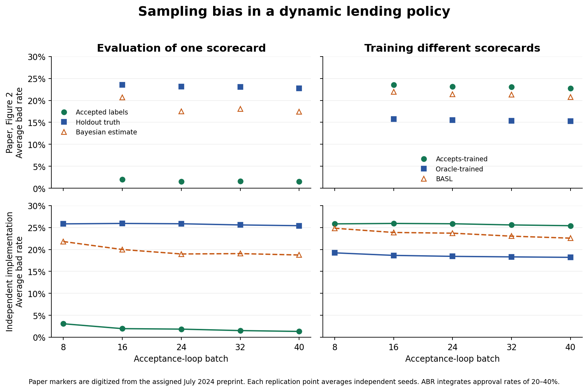
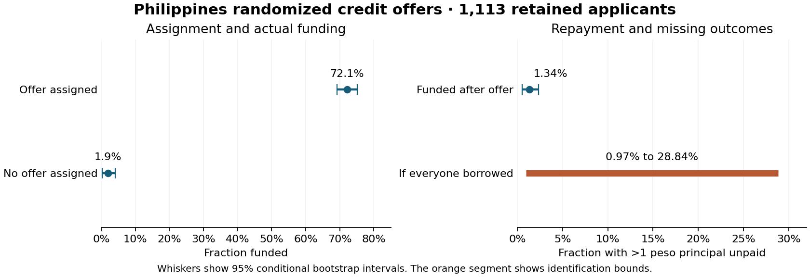

# Team 12 · Fighting Sampling Bias

**Implementation and computational experiments · Andrey Tsember**

Team 12 · Andrey Tsember, Sofia Shapovalova, Ksenia Stepanova, Marat Bineman and Alexia Fox.

This report uses the assigned preprint and public borrower records. An approval scorecard is needed for everyone who applies, while repayment is usually observed only for the people actually financed. Training with inferred labels and evaluating on the complete applicant mix solve different problems.

## Synthetic replication of Figure 2

| statistic | paper_value | estimate | ci_low | ci_high |
|---|---|---|---|---|
| accept_eval_rmse | 0.2010 | 0.2433 | 0.2218 | 0.2648 |
| bayes_eval_rmse | 0.0929 | 0.0771 | 0.0618 | 0.0932 |
| oracle_gap | 0.0598 | 0.0715 | 0.0595 | 0.0846 |
| basl_recovery_fraction | 0.2482 | 0.2961 | 0.2122 | 0.3728 |

Twenty independent runs, 40 batches each. Intervals resample complete simulation seeds. Recovery is a fraction of the gap between accepted-only and full-label training. Evaluation error is measured against true holdout labels. The first four shared plotted checkpoints are displayed on identical axes. The published long-run summaries cover a longer experiment.

## Published Monedo versus our public-cohort experiments

Table 2 compares errors in prediction of a scorecard metric; smaller is better. Table 3 compares scorecards on held-out borrowers. Smaller Brier and ABR, higher AUC and pAUC are better. The reweighting rows compare different weight estimators. Targets, default rates and approval mechanisms differ across datasets.

| table | method | monedo | taiwan | prosper |
|---|---|---|---|---|
| 2 | accepts | 0.0356 | 0.0143 | 0.0135 |
| 2 | bayes | 0.0130 | 0.0135 | 0.0035 |
| 2 | ipw | 0.0315 | 0.0105 | 0.0068 |
| 3 | accepts | 0.2388 | 0.0720 | 0.0340 |
| 3 | basl | 0.2211 | 0.0737 | 0.0341 |
| 3 | hard_cutoff | 0.2458 | 0.0739 | 0.0402 |
| 3 | ipw | 0.2346 | 0.0723 | 0.0329 |

The complete four-metric comparison is in [paper_comparison.csv](paper_comparison.csv).

## Training, risk lift and calibration

| dataset | method | auc | brier | pauc | abr | lift10 |
|---|---|---|---|---|---|---|
| prosper | accepts | 0.6313 | 0.0596 | 0.5660 | 0.0340 | 1.9784 |
| prosper | basl | 0.6350 | 0.0596 | 0.5633 | 0.0341 | 2.0036 |
| prosper | basl_guarded | 0.6350 | 0.0596 | 0.5633 | 0.0341 | 2.0036 |
| prosper | hard_cutoff | 0.5984 | 0.0605 | 0.5487 | 0.0402 | 1.6547 |
| prosper | ipw | 0.6291 | 0.0598 | 0.5667 | 0.0329 | 1.8885 |
| prosper | logit | 0.6116 | 0.0599 | 0.5563 | 0.0367 | 1.7266 |
| taiwan | accepts | 0.7766 | 0.1357 | 0.6338 | 0.0720 | 3.1332 |
| taiwan | basl | 0.7768 | 0.1360 | 0.6317 | 0.0737 | 3.1349 |
| taiwan | basl_guarded | 0.7766 | 0.1360 | 0.6324 | 0.0731 | 3.1364 |
| taiwan | hard_cutoff | 0.7748 | 0.1433 | 0.6302 | 0.0739 | 3.1558 |
| taiwan | ipw | 0.7768 | 0.1361 | 0.6334 | 0.0723 | 3.1273 |
| taiwan | logit | 0.7218 | 0.1485 | 0.5659 | 0.1212 | 3.0487 |

Lift10 is the bad rate in the riskiest tenth divided by the population bad rate. The Taiwan test shows a modest increase in bad loans among the safest borrowers under BASL. The Prosper training contrast is small relative to its interval. The simulated training improvement does not transfer consistently.

The diagonal represents perfect calibration. Each point represents an equal-frequency group (ties kept together); the cohorts have separate scales. Calibration measures agreement between predicted and observed frequencies, while AUC measures ordering.

## Exposure to the prior

| method | prosper | taiwan |
|---|---|---|
| accepts | 0.0135 | 0.0143 |
| bayes | 0.0035 | 0.0135 |
| bayes_odds_double | 0.0025 | 0.0370 |
| bayes_odds_half | 0.0068 | 0.0082 |
| ipw | 0.0068 | 0.0105 |

The central Bayesian prior is a logit trained only on observed training outcomes. Halving or doubling reject odds leaves the scorecard and its rankings unchanged. It changes which hidden outcomes are assumed when estimating performance. A stronger prior in one cohort can be worse in another. Taiwan RMSE uses four folds; the single chronological Prosper split yields an absolute error.

The complete labels in the validation cohort also allow a retrospective test that removes population transfer. On Taiwan the accepted-only and Bayesian errors are 0.0059 and 0.0179, respectively. On Prosper they are 0.0113 and 0.0013. Taiwan's small improvement on an independent same-vintage sample therefore cannot be attributed solely to correcting selection.

## Paired uncertainty

| dataset | contrast | estimate | ci_low | ci_high |
|---|---|---|---|---|
| taiwan | basl_minus_accepts_abr | 0.0016 | 0.0002 | 0.0030 |
| taiwan | bayes_minus_accepts_profit_at_lgd50 | 0.0000 | 0.0000 | 0.0000 |
| taiwan | basl_minus_accepts_brier | 0.0003 | 0.0000 | 0.0006 |
| taiwan | bayes_minus_accepts_rmse_abr | -0.0008 | -0.0095 | 0.0078 |
| prosper | basl_minus_accepts_abr | 0.0001 | -0.0022 | 0.0026 |
| prosper | bayes_minus_accepts_profit_at_lgd50 | 0.0000 | 0.0000 | 0.0000 |
| prosper | basl_minus_accepts_brier | 0.0000 | -0.0002 | 0.0002 |
| prosper | bayes_minus_accepts_rmse_abr | -0.0100 | -0.0133 | 0.0053 |

Training comparisons use the same test borrowers under both models. Evaluation-error comparisons assign each borrower one shared Poisson weight wherever it recurs across folds. Intervals are conditional on fitted models and logged decisions. Both empirical intervals for the change in ABR estimation error include zero. Zero conditional policy variance at the base LGD means the methods took the same decisions on these cases.

## Conditional lending policy

| dataset | lgd | accepts | bayes | ipw | bayes_minus_accepts |
|---|---|---|---|---|---|
| prosper | 0.2500 | 0.0431 | 0.0431 | 0.0431 | 0.0000 |
| prosper | 0.5000 | 0.0378 | 0.0378 | 0.0378 | 0.0000 |
| prosper | 0.7500 | 0.0325 | 0.0325 | 0.0325 | 0.0000 |
| prosper | 1.0000 | 0.0272 | 0.0272 | 0.0272 | 0.0000 |
| taiwan | 0.2500 | 0.0372 | 0.0372 | 0.0372 | 0.0000 |
| taiwan | 0.5000 | 0.0242 | 0.0242 | 0.0242 | 0.0000 |
| taiwan | 0.7500 | 0.0124 | 0.0118 | 0.0124 | -0.0006 |
| taiwan | 1.0000 | 0.0067 | 0.0062 | 0.0067 | -0.0006 |

The entries are margin in units of principal per arriving applicant using an assumed 10% return if repaid. Issuance rates, per-issued-unit margins and numerical cutoffs are in [policy.csv](policy.csv). At 50% LGD all three estimators select the upper end of the allowed rate grid, so the realized difference is exactly zero. The paper’s stated gain in profit depends on its pricing, approval decisions and Spanish borrower population.

## Can a small randomized audit improve ABR measurement?

| dataset | n_audited | design | audit_rmse | prior_only_rmse |
|---|---|---|---|---|
| prosper | 10 | all_rejects | 0.0289 | 0.0003 |
| prosper | 10 | policy_rejects | 0.0088 | 0.0003 |
| prosper | 50 | all_rejects | 0.0111 | 0.0003 |
| prosper | 50 | policy_rejects | 0.0031 | 0.0003 |
| taiwan | 10 | all_rejects | 0.0455 | 0.0188 |
| taiwan | 10 | policy_rejects | 0.0195 | 0.0188 |
| taiwan | 50 | all_rejects | 0.0201 | 0.0188 |
| taiwan | 50 | policy_rejects | 0.0086 | 0.0188 |

For a fixed proposed 30% approval policy, each audit reveals 10 or 50 funded outcomes under controlled masking. Both designs reveal the same number of outcomes. Financial exploration costs may differ. Targeting only previously declined borrowers whom this policy would approve lowers sampling variability. Compare against prior-only RMSE as well: a good prior can beat a noisy small audit on a given cohort. Random disclosure identifies the fixed-policy default rate in this finite validation cohort; small samples may still be imprecise. Each result pools squared error across 500 draws per split before taking the square root.

## Our extensions

[What the authors did, what Team 12 added, and how the evidence compares with Paper 15](../docs/contributions.md)

### Correcting old labels versus predicting the next quarter

| method | quarters | masking_rmse | forecast_rmse | quarters_better_than_accepts |
|---|---|---|---|---|
| accepts | 12 | 0.7856 | 2.0751 | 0 |
| bayes | 12 | 0.2614 | 2.3566 | 7 |
| ipw | 12 | 0.1698 | 2.3915 | 7 |
| oracle_history | 12 | 0.0000 | 2.2677 | 7 |

Both RMSE columns above are in percentage points of integrated ABR. Bayesian evaluation improves historical measurement but produces larger next-quarter RMSE over twelve Prosper cohorts, despite winning in seven individual quarters. The historical oracle uses complete previous outcomes and still experiences temporal transfer error. [Period definitions and error decomposition](../docs/vintages.md)

### Prior sensitivity at a lending decision

With 10% interest, 50% LGD and a fixed 30% incumbent, the validation lower bound for the 50% expansion's conditional expected margin stays nonnegative up to an odds multiplier of 1.85–2.30 in Taiwan and 13.19 on Prosper. Absolute cutoffs are frozen before testing. With unrestricted missing outcomes a zero-downside validation rule retains the incumbent. These are sensitivity endpoints, distinct from sampling confidence intervals. [Definitions, paired gains and held-out results](../docs/bounds.md)

### Randomized offers and actual borrowing in the Philippines

The analytic extract contains 1,113 marginal applicants. Expanding offers from the high score window to both windows changes the funding rate by 8.02 percentage points and the lender cash margin by 4.19 PPP dollars per assigned applicant (95% bootstrap interval 3.02 to 5.45), before other costs. The result refers to this selected extract under within-window comparability. The underlying experiment was conducted by Karlan and Zinman.

The estimated share with a principal shortfall greater than one peso under hypothetical universal funding is only bounded between 0.97% and 28.84% if the non-takers’ repayment is unrestricted. This identified set has a different interpretation from a confidence interval. As a sparse check of a risk prior carried over from the high score window, the observed lower window has 2 shortfalls among 50 funded borrowers versus 0.50 expected. [Assumptions, primary sources and exact rare-event comparison](../docs/rct.md)

## Limits and a three-month follow-up

We can test label concealment among already funded borrowers. A randomized sample of actual would-be declines with mature repayment labels would identify the target population more directly. Collect such a sample under a fixed decision policy, estimate default and realized net revenue with funding costs, and repeat across time vintages and adequate overlap regions. Twelve Prosper quarters provide evidence on temporal transfer at one lender. Profit net of financing and servicing costs and transport to other macroeconomic conditions still require additional data.

[Data provenance](../docs/sources.md) · [Implementation](../docs/algorithm.md) · [Deviations](../docs/deviations.md) · [Simulation](../docs/simulation.md)
